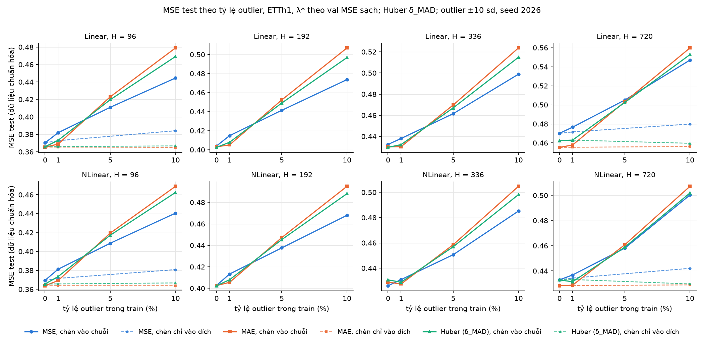
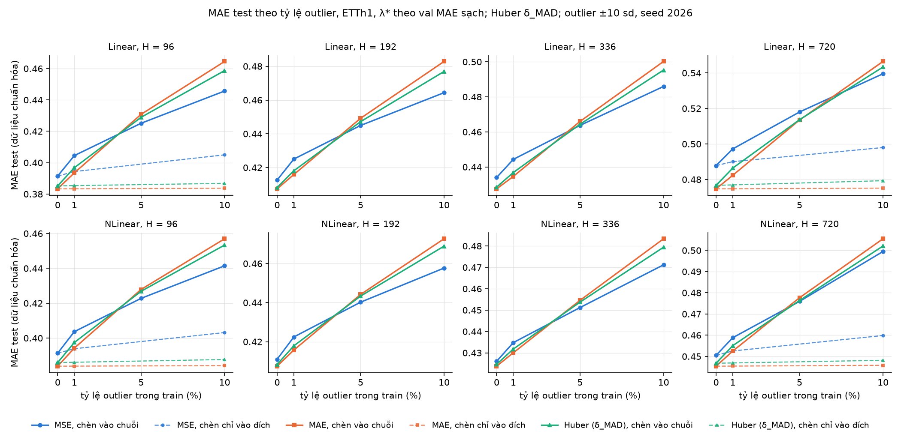
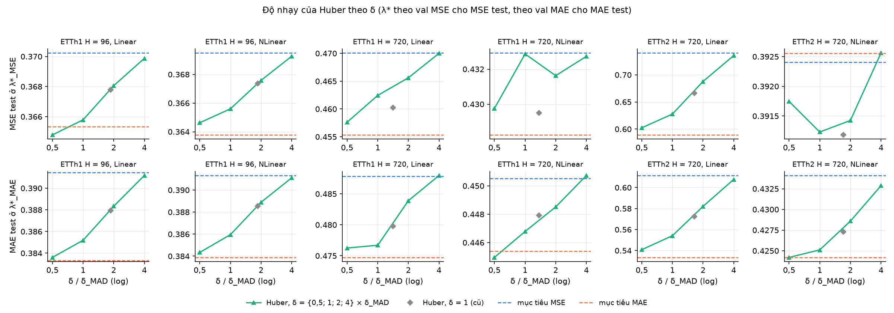

# Nhiệm vụ 7: áp dụng góp ý của TA (δ của Huber, tiêu chí chọn λ*, độ lớn outlier, SGD tinh chỉnh lr)

Ngày chạy: 08/10/2026. Nhiệm vụ: [NHIEM_VU_7.md](NHIEM_VU_7.md). Tiếp theo [BAO_CAO_OUTLIER.md](BAO_CAO_OUTLIER.md) và [BAO_CAO_SGD_B1_B4.md](BAO_CAO_SGD_B1_B4.md).

- Code: [`src/solvers.py`](../src/solvers.py) (`huber_delta_mad`), [`scripts/runner.py`](../scripts/runner.py) (`--huber-delta`, `--delta-scale`, `--skip-mse`, `--outlier-magnitude`), [`scripts/select_lambda.py`](../scripts/select_lambda.py) (`--selections`, nhiều `--in`), [`scripts/huber_deltas.py`](../scripts/huber_deltas.py), [`scripts/sgd_lr_tune.py`](../scripts/sgd_lr_tune.py), [`scripts/report_nv7.py`](../scripts/report_nv7.py) (mọi bảng và hình dưới đây). Test mới: [`tests/test_val_metrics.py`](../tests/test_val_metrics.py), `TestHuberDeltaMAD` trong [`tests/test_solvers.py`](../tests/test_solvers.py).
- Số liệu:
  - B: [`results/results_v2.csv`](../results/results_v2.csv) (grid, Huber δ = 1), [`results/outliers/results_v2.csv`](../results/outliers/results_v2.csv);
  - A: [`results/huber_mad/deltas.csv`](../results/huber_mad/deltas.csv), [`results/huber_mad/lambda_path.csv`](../results/huber_mad/lambda_path.csv) (grid), [`results/huber_mad/outliers/`](../results/huber_mad/outliers/), [`results/huber_mad/sens_x{0.5,2,4}/`](../results/huber_mad/), kiểm trước ở [`results/huber_mad/check_delta1/`](../results/huber_mad/check_delta1/); **B3 hoàn chỉnh: [`results/huber_mad/results_v2.csv`](../results/huber_mad/results_v2.csv)** (MSE, MAE từ grid; Huber δ_MAD); outlier với Huber δ_MAD: [`results/huber_mad/outliers/results_v2.csv`](../results/huber_mad/outliers/results_v2.csv);
  - C: [`results/outliers_mag/`](../results/outliers_mag/);
  - D: [`results/sgd_lr/`](../results/sgd_lr/) (`selection.json`, 990 JSON mới), cộng các lần chạy có sẵn ở `results/sgd_b1_b4/`, `results/sgd_etth2_20seed/`, `results/outliers/d2_lr/`;
  - bảng: [`results/nv7/tables_{A,B,C,D}.md`](../results/nv7/), `summary.json`; hình: `results/outliers/H2_v2_outlier_robustness{,_mae}.png`, `results/huber_mad/A3_delta_sensitivity.png`, `results/outliers_mag/C_outlier_magnitude.png`.
- Máy: RTX 5060 Ti (A, C), CPU Intel 12 luồng (D), torch 2.14.0+cu130 (`.venv-gpu`), TF32 tắt. Cấu hình bộ giải như grid (chế độ pha, chunk 16, dừng (a′) cho MAE, tol 1e-9 cho Huber, MSE dạng đóng, warm start, fallback float64 theo h).
- Test: 60 → **63, tất cả đạt** (`.venv-gpu/Scripts/python -m unittest discover -s tests -t .`).
- Thay đổi code: [NHAT_KY_THAY_DOI.md](NHAT_KY_THAY_DOI.md), mục 12.

Ký hiệu: **tiêu chí mới** (B.1) là MSE test báo ở λ*_MSE = argmin MSE val, MAE test ở λ*_MAE = argmin MAE val, cùng quy tắc cho mọi mô hình và mục tiêu. **Tiêu chí cũ** là `val_objective` (λ* theo metric val của chính mục tiêu), cách chọn của bảng chính trong các báo cáo trước. δ_MAD = 1,345 · 1,4826 · MAD của phần dư train của nghiệm MSE λ = 0 (A.1). Mọi MSE/MAE tính trên dữ liệu đã chuẩn hóa. Test không dùng để chọn λ, δ, lr hay epoch.

## 1. Kết luận

__KET_LUAN__

## 2. Những kết luận đổi so với các báo cáo trước

Lý do đổi: **[λ]** tiêu chí chọn λ* mới (B.1); **[δ]** Huber dùng δ_MAD thay δ = 1; **[lr]** SGD tinh chỉnh lr (và chạy cuối trên 15 seed mới); **[seed]** chỉ do bớt seed (20 → 15), không do lr. "Giữ" nghĩa là kết luận cũ vẫn đúng sau khi áp mọi thay đổi.

| # | Kết luận cũ (báo cáo) | Giá trị cũ | Giá trị mới | Lý do |
|---|---|---|---|---|
| 1 | Thứ hạng mục tiêu theo MAE test trong B3 (grid) | MAE tốt nhất 34/36 ô | MAE 33/36, Huber 2, MSE 1 | [δ]: ETTh2 NLinear H = 96 MAE → Huber, H = 336 Huber → MSE; [λ] không đổi ô nào |
| 2 | Thứ hạng mục tiêu theo MSE test trong B3 | MSE / MAE / Huber tốt nhất ở 5 / 23 / 8 ô | 5 / 24 / 7 | [λ]: thứ hạng đổi ở 7/36 ô; [δ]: hạng của Huber đổi thêm ở 6 ô (mục 4.4) |
| 3 | "Huấn luyện bằng MAE cho MSE test tốt hơn MSE", ETTh1 (BAO_CAO_OUTLIER mục 7) | 2/4 H với cả Linear, DLinear, NLinear | Linear 4/4, DLinear 4/4, NLinear 3/4 | [λ] |
| 4 | Như trên, ETTh2 và ETTm1 | ETTh2: Linear, DLinear 4/4, NLinear 0/4; ETTm1: 4/4, 4/4, 3/4 | giữ | — |
| 5 | Huber với Linear tốt nhất theo MSE test ở ETTh1 H = 192, 336 | Huber < MSE < MAE ở H = 192 (cả 3 mô hình) và H = 336 (Linear, DLinear) | H = 192: Huber tốt nhất với Linear, NLinear, MAE với DLinear; H = 336: Huber với Linear, DLinear, MSE với NLinear | [λ] và [δ] (mục 3.3, 4.4); chênh giữa ba mục tiêu ở các ô này dưới 0,005 |
| 6 | λ* của DLinear ETTh1 H = 96 (BAO_CAO_5060TI mục 1: 100 theo chính mục tiêu, 300 theo MSE; BAO_CAO_ETTH2_SGD: MSE 446,7) | MAE, Huber: báo ở λ = 100 | MSE test báo ở λ*_MSE = 300, MAE test ở λ*_MAE = 100 (MAE, Huber δ = 1, Huber δ_MAD); MSE: 446,7 | [λ]; MSE test của MAE 0,3651 → 0,3647 |
| 7 | Bảng xếp hạng mục tiêu trong thí nghiệm outlier (BAO_CAO_OUTLIER mục 1) | MSE test tốt nhất ở 0% / 1% / 5% / 10%: MSE 1/0/7/8, MAE 4/8/0/0, Huber 3/0/1/0 | 0%: 1 / 4 / 3 (MSE / MAE / Huber; [λ] làm 1 / 5 / 2, [δ] đưa lại 1 / 4 / 3); 1%, 5%, 10%: giữ | [λ], [δ] chỉ ở rate 0 |
| 8 | Thứ tự suy giảm 0 → 10% (chuỗi): MSE < Huber < MAE ở 8/8 ô | Huber +0,070 đến +0,101 | Huber δ_MAD +0,067 đến +0,103; thứ tự giữ ở 8/8 ô | [δ], giữ |
| 9 | Chèn chỉ vào đích: MAE và Huber đổi MSE test không quá 0,0005 ở rate 10% | Huber ≤ 0,0005 | Huber δ_MAD: −0,0032 đến +0,0011 (vẫn nhỏ so với MSE +0,009 đến +0,014) | [δ] |
| 10 | B.5: ở 10%, thứ tự MSE so với Huber nằm trong nhiễu theo vị trí outlier | seed 2027: MSE hơn Huber 0,0003 | MSE < Huber < MAE ở cả 3 seed, seed 2027 hơn 0,0012; độ lệch seed vẫn cùng cỡ khác biệt mục tiêu | [δ], kết luận giữ |
| 11 | B4: số ô theo nhãn (BAO_CAO_SGD_B1_B4) | SGD tốt hơn thật 6, dạng đóng tốt hơn thật 10, khớp val quá mức 12, val khác test 7, không phân biệt 1 | 5 / 2 / 16 / 9 / 4 | [lr] ở 13 ô, [seed] ở 2 ô (mục 6.3) |
| 12 | "SGD tốt hơn thật" chỉ ở ETTh2 với Linear/DLinear | 6 ô | 5 ô, vẫn chỉ ETTh2 Linear/DLinear; ETTh2 Linear H = 720 (chọn ×0,5) thành "không phân biệt được" | [lr] |
| 13 | SGD kém dạng đóng trên test ở 24/24 ô ETTh1, ETTm1 | Δ test ETTh1 +0,003 đến +0,040, ETTm1 +0,0025 đến +0,0104 | vẫn 24/24 theo trung bình (23/24 có ý nghĩa); ETTh1 +0,0025 đến +0,029, ETTm1 +0,0022 đến +0,0100 | [lr]: tinh chỉnh lr không đóng được khoảng cách |
| 14 | ETTm1: "dạng đóng tốt hơn thật" ở 7 ô | 7 ô | 0 ô; 7 ô cũ thành "SGD có dấu hiệu khớp val quá mức" (5) hoặc "khác biệt do val khác test" (2): SGD tinh chỉnh thắng hoặc hòa trên val nhưng vẫn thua trên test | [lr] |
| 15 | C.3: DLinear tốt hơn Linear có ý nghĩa ở 4/12 ô, đều ETTm1 | Δ test −0,0032 đến −0,0047 | **0/12 ô**; ETTm1: −0,0020 đến +0,0002, mọi CI chứa 0 | [lr] |
| 16 | B1 (số công bố so với 20 seed SGD) | — | không đổi (B1 dùng lr gốc để tái lập, đúng góp ý 5 của TA) | — |

Các kết luận khác của BAO_CAO_OUTLIER (λ* về 0 khi có outlier trong chuỗi, NLinear suy giảm ít hơn Linear, chèn chỉ vào đích làm MSE suy giảm) dùng MSE, MAE nên không đổi theo [δ]; [λ] không đổi mục tiêu tốt nhất ở rate > 0 (mục 3.5).

## 3. Phần B: đổi tiêu chí chọn λ*

Bảng đầy đủ: [`results/nv7/tables_B.md`](../results/nv7/tables_B.md). Phần này không chạy lại gì; Huber ở đây vẫn là δ = 1.

### 3.1. Kiểm

- **`val_mae` thêm vào `select_lambda.py`** (`--selections val_mse val_mae val_objective`). Với tham số mặc định, `results.csv` và `results/outliers/results.csv` sinh lại trùng từng byte bản cũ; 432/432 dòng (`val_objective`, `val_mse`) của `results.csv` có trong `results_v2.csv` với cùng λ, MSE test, MAE test.
- **Metric val không chứa phạt.** Trong `runner.py`, `val_mse`, `val_mae`, `val_huber` tính từ phần dư val (`Cell.evaluate`), còn λ‖w‖² chỉ cộng vào `train_obj`. `tests/test_val_metrics.py` nạp W đã lưu (ETTh1 H = 96: 102 dòng; ETTh2 H = 336: 99 dòng; mọi λ > 0 của MAE, Huber, mỗi λ thứ 10 của MSE), tính lại cả ba metric trên cửa sổ val và so với CSV: **mọi chênh ≤ 1e-12 tương đối**. Phản chứng: số hạng phạt (chuẩn hóa như `train_obj`) ở dòng nhỏ nhất là 2,3e-8 tương đối, lớn hơn ngưỡng 2·10⁴ lần, nên test sẽ bắt được nếu metric val có phạt. Test bỏ qua khi thiếu `results/weights/` (bị .gitignore).
- **B4 không đổi:** λ* của mục tiêu MSE theo `val_mse` trùng λ* mà `report_sgd_b1_b4.py` đọc (`val_objective` của MSE) ở 36/36 ô.

### 3.2. Cột nào đổi

Theo định nghĩa, với mục tiêu MSE thì MSE test giữ nguyên, còn MAE test đổi sang λ*_MAE; với MAE thì MAE test giữ nguyên, MSE test đổi sang λ*_MSE; với Huber cả hai đổi. Số ô (trên 36) có λ* mới khác λ* cũ:

| Mục tiêu | MSE test (λ*_MSE ≠ λ* cũ) | MAE test (λ*_MAE ≠ λ* cũ) |
|---|---|---|
| MSE | 0 | 30 |
| MAE | 24 | 0 |
| Huber (δ = 1) | 13 | 16 |

### 3.3. Thứ hạng mục tiêu trong từng ô B3 (Huber δ = 1)

**Theo MAE test: thứ hạng không đổi ở 36/36 ô** (MAE tốt nhất ở 34/36 ô cả trước lẫn sau). **Theo MSE test: đổi ở 7/36 ô**, mục tiêu tốt nhất đổi ở 4 ô:

| Dataset | H | Mô hình | cũ | mới | MSE test mới (MSE / MAE / Huber) |
|---|---|---|---|---|---|
| ETTh1 | 192 | Linear | Huber < MSE < MAE | Huber < MAE < MSE | 0,4040 / 0,4031 / 0,4026 |
| ETTh1 | 192 | DLinear | Huber < MSE < MAE | MAE < Huber < MSE | 0,4036 / 0,4014 / 0,4022 |
| ETTh1 | 192 | NLinear | Huber < MSE < MAE | Huber < MAE < MSE | 0,4027 / 0,4026 / 0,4025 |
| ETTh1 | 336 | Linear | Huber < MSE < MAE | MAE < Huber < MSE | 0,4324 / 0,4302 / 0,4304 |
| ETTh1 | 336 | DLinear | Huber < MSE < MAE | MAE < Huber < MSE | 0,4317 / 0,4296 / 0,4300 |
| ETTm1 | 192 | DLinear | MAE < MSE < Huber | MAE < Huber < MSE | 0,3339 / 0,3319 / 0,3339 |
| ETTm1 | 720 | NLinear | MSE < Huber < MAE | Huber < MSE < MAE | 0,4262 / 0,4270 / 0,4261 |

Cả 7 thay đổi đến từ MSE test của MAE hoặc Huber, vốn trước đây báo ở λ* theo metric val của chính chúng. Ở các ô λ* đó khác λ*_MSE, nó nhỏ hơn λ*_MSE ở 24/24 ô với MAE và 11/13 ô với Huber. Với tiêu chí mới, MSE test của mọi mục tiêu đều báo ở λ*_MSE của chính đường λ đó, nên lợi thế của MSE trên MSE test ở ETTh1 H = 192, 336 biến mất. Vị trí của Huber trong các thứ hạng này **chờ Phần A**, xem mục 4.4.

### 3.4. "Huấn luyện bằng MAE cho MSE test tốt hơn huấn luyện bằng MSE"

Số H (trên 4) có MSE test(MAE) < MSE test(MSE):

| Dataset | Mô hình | cũ | mới | chênh mới theo H = 96 / 192 / 336 / 720 (dương: MAE tốt hơn) |
|---|---|---|---|---|
| ETTh1 | Linear | 2 | **4** | 0,0049 / 0,0009 / 0,0022 / 0,0147 |
| ETTh1 | DLinear | 2 | **4** | 0,0051 / 0,0021 / 0,0022 / 0,0148 |
| ETTh1 | NLinear | 2 | **3** | 0,0057 / 0,0002 / −0,0028 / 0,0047 |
| ETTh2 | Linear | 4 | 4 | 0,0230 / 0,0435 / 0,0748 / 0,1511 |
| ETTh2 | DLinear | 4 | 4 | 0,0230 / 0,0435 / 0,0747 / 0,1511 |
| ETTh2 | NLinear | 0 | 0 | −0,0047 / −0,0110 / −0,0178 / −0,0002 |
| ETTm1 | Linear | 4 | 4 | 0,0063 / 0,0018 / 0,0026 / 0,0016 |
| ETTm1 | DLinear | 4 | 4 | 0,0063 / 0,0020 / 0,0028 / 0,0018 |
| ETTm1 | NLinear | 3 | 3 | 0,0067 / 0,0020 / 0,0018 / −0,0009 |

Chỉ ETTh1 đổi: từ 2/4 lên 4/4 (Linear, DLinear) và 3/4 (NLinear). Ở ETTh1 H = 192 chênh chỉ 0,0002–0,0021, nhỏ hơn nhiều so với ETTh2.

### 3.5. Thí nghiệm outlier

Với rate > 0, **mục tiêu tốt nhất không đổi ở ô nào** (chèn vào chuỗi và chèn chỉ vào đích, cả MSE test lẫn MAE test). Chỉ ô rate 0% (grid gốc) đổi: Linear H = 336 theo MSE test, Huber → MAE. Đếm mục tiêu tốt nhất theo MSE test, chèn vào chuỗi (8 ô): rate 0% từ 1 / 4 / 3 (MSE / MAE / Huber) thành 1 / 5 / 2; 1%, 5%, 10% giữ nguyên (0 / 8 / 0, 7 / 0 / 1, 8 / 0 / 0). Suy giảm MSE test 0 → 10% của MAE thành 0,0758–0,1136 (cũ 0,0730–0,1136); thứ tự suy giảm MSE < Huber < MAE vẫn đúng ở 8/8 ô.

### 3.6. λ* của DLinear, ETTh1, H = 96

| Mục tiêu | λ* cũ (val_objective) | λ*_MSE | λ*_MAE | MSE test cũ → mới | MAE test cũ → mới |
|---|---|---|---|---|---|
| MSE | 446,7 | 446,7 | 446,7 | 0,3698 → 0,3698 | 0,3914 → 0,3914 |
| MAE | 100 | 300 | 100 | 0,3651 → 0,3647 | 0,3832 → 0,3832 |
| Huber δ = 1 | 100 | 300 | 100 | 0,3675 → 0,3671 | 0,3879 → 0,3879 |
| Huber δ_MAD (Phần A) | 100 | 300 | 100 | 0,3656 → 0,3652 | 0,3851 → 0,3851 |

## 4. Phần A: δ của Huber theo thang phần dư

Bảng đầy đủ: [`results/nv7/tables_A.md`](../results/nv7/tables_A.md).

### 4.1. δ_MAD (A.1)

Với mỗi (dataset, H, mô hình, tập train): lấy nghiệm MSE λ = 0 của chính mô hình (NLinear: có ràng buộc) trên chính tập train đó, tính phần dư train R (n × H phần tử), σ̂ = 1,4826 · median(|R − median(R)|), δ = 1,345 · σ̂ (`src.solvers.huber_delta_mad`, gọi qua `runner.Cell.huber_delta`).

- **Grid gốc: δ_MAD từ 0,372 (ETTh2 H = 96, NLinear) đến 0,732 (ETTh1 H = 720, NLinear), trung vị 0,537**, tức bằng 0,37–0,73 lần δ = 1 cũ. δ tăng theo H ở cả ba dataset.
- **DLinear trùng Linear từng bit ở 12/12 ô** (cùng nghiệm MSE λ = 0).
- **Tập train đã chèn outlier:** δ_MAD 0,546–1,111, tăng theo rate và độ lớn. Ví dụ Linear H = 96, chèn vào chuỗi ±10: 0,538 (0%) → 0,629 (1%) → 0,803 (5%) → 0,944 (10%). MAD bền vững với outlier trong phần dư, nhưng outlier trong x làm cả nghiệm MSE xấu đi, nên phần dư của các điểm không bị chèn cũng lớn hơn.
- **Không ô nào ngoài [0,05; 5]** (88 tập train), nên không chạm điểm dừng của mục 7.
- **σ̂ theo từng h khác nhau nhiều trong một ô:** max/min trên H bước từ 2,5 (ETTh1 H = 96) đến 5,0 (ETTh2 H = 720, NLinear). Trung vị theo h gần σ̂ gộp (chênh dưới 10%). Một δ chung cho cả ô vì vậy nằm trong vùng bậc hai với các bước h có phần dư nhỏ nhất và gần vùng tuyến tính với các bước h xa nhất. Đề không yêu cầu δ theo h nên không chạy; chỉ ghi lại.

| Dataset | H | Mô hình | δ_MAD | σ̂ | σ̂ theo h: min / trung vị / max |
|---|---|---|---|---|---|
| ETTh1 | 96 | Linear | 0,5380 | 0,4000 | 0,1804 / 0,4049 / 0,4425 |
| ETTh1 | 96 | NLinear | 0,5378 | 0,3998 | 0,1804 / 0,4036 / 0,4447 |
| ETTh1 | 192 | Linear | 0,5816 | 0,4324 | 0,1801 / 0,4434 / 0,4825 |
| ETTh1 | 192 | NLinear | 0,5865 | 0,4361 | 0,1802 / 0,4459 / 0,4929 |
| ETTh1 | 336 | Linear | 0,6213 | 0,4620 | 0,1803 / 0,4749 / 0,5228 |
| ETTh1 | 336 | NLinear | 0,6290 | 0,4676 | 0,1801 / 0,4822 / 0,5320 |
| ETTh1 | 720 | Linear | 0,7090 | 0,5271 | 0,1793 / 0,5259 / 0,6636 |
| ETTh1 | 720 | NLinear | 0,7315 | 0,5438 | 0,1793 / 0,5372 / 0,7079 |
| ETTh2 | 96 | Linear | 0,3983 | 0,2961 | 0,1311 / 0,3143 / 0,3581 |
| ETTh2 | 96 | NLinear | 0,3718 | 0,2765 | 0,1305 / 0,2884 / 0,3277 |
| ETTh2 | 192 | Linear | 0,4527 | 0,3366 | 0,1310 / 0,3580 / 0,4037 |
| ETTh2 | 192 | NLinear | 0,4213 | 0,3132 | 0,1306 / 0,3268 / 0,3801 |
| ETTh2 | 336 | Linear | 0,5052 | 0,3756 | 0,1307 / 0,3916 / 0,4579 |
| ETTh2 | 336 | NLinear | 0,4701 | 0,3495 | 0,1304 / 0,3648 / 0,4317 |
| ETTh2 | 720 | Linear | 0,6096 | 0,4532 | 0,1296 / 0,4564 / 0,5956 |
| ETTh2 | 720 | NLinear | 0,5874 | 0,4368 | 0,1295 / 0,4362 / 0,6495 |
| ETTm1 | 96 | Linear | 0,4552 | 0,3384 | 0,1070 / 0,3684 / 0,3727 |
| ETTm1 | 96 | NLinear | 0,4530 | 0,3368 | 0,1069 / 0,3656 / 0,3715 |
| ETTm1 | 192 | Linear | 0,4967 | 0,3693 | 0,1069 / 0,3724 / 0,4105 |
| ETTm1 | 192 | NLinear | 0,4930 | 0,3665 | 0,1068 / 0,3711 / 0,4081 |
| ETTm1 | 336 | Linear | 0,5363 | 0,3987 | 0,1070 / 0,4070 / 0,4582 |
| ETTm1 | 336 | NLinear | 0,5336 | 0,3967 | 0,1068 / 0,4040 / 0,4584 |
| ETTm1 | 720 | Linear | 0,5893 | 0,4381 | 0,1066 / 0,4550 / 0,4999 |
| ETTm1 | 720 | NLinear | 0,5892 | 0,4381 | 0,1065 / 0,4551 / 0,5064 |

DLinear: δ bằng Linear. Test của `huber_delta_mad`: với N(0,2; s²), s ∈ {0,1; 0,5; 1; 3}, 10⁶ phần tử, σ̂ lệch s dưới 5%; thêm 5% phần tử ±50 làm σ̂ đổi dưới 10% trong khi độ lệch chuẩn tăng hơn 10 lần.

### 4.2. Kiểm trước và đường λ (A.2)

- **Kiểm trước:** code mới với δ = 1 (`--huber-delta 1 --skip-mse`, λ = 0 khởi tạo từ `closed_form` tính lại) cho Linear ETTh1 H = 96: **10/10 dòng trùng `lambda_path.csv` tuyệt đối** (chênh 0 ở `train_obj` và mọi metric val, test), cùng số vòng IRLS. Tốt hơn ngưỡng 1e-10.
- **Grid (36 đường, 373 dòng):** quy ước phạt chia cho δ (Σρ_δ/δ + λ‖w‖²), nên δ nhỏ hơn đẩy λ* lên. **9 đường phải mở rộng đầu mút trên**: ETTh1 H = 336 (Linear, DLinear +1; NLinear +2), ETTh1 H = 720 (cả ba mô hình +2, tới λ = 9·10⁴), ETTm1 H = 192, 336, 720 NLinear (+1). Sau khi mở rộng, **không đường nào có λ*_MSE hay λ*_MAE ở đầu mút trên** (λ*_MSE lớn nhất 3·10⁴ ở ETTh1 H = 720).
- **Outlier (36 đường, 408 dòng):** 28 đường mở rộng, phần lớn ở đầu dưới (λ* = 0 ở cả 36 (đường, metric) của rate 5%, 10%, nên runner chèn 1/3, 1/9). Không đường nào ở đầu mút trên sau khi mở rộng. λ = 0 là biên thật (λ ≥ 0), không phải giới hạn của lưới, nên không tính là chạm đầu mút theo nghĩa của mục 7.
- **Không dòng `converged = False`, không `RuntimeError: J tăng`, không bước h nào cần fallback float64** ở grid, outlier, A.3 và C.
- **Thời gian:** δ_MAD làm IRLS chậm hơn δ = 1 khoảng 1,3 lần (đo trên Linear ETTh1 H = 720, λ = 0: 7 → 9 vòng; ×0,5: 14 vòng). Grid 48 phút, outlier 22 phút, A.3 19 phút.

### 4.3. B3 hoàn chỉnh (tiêu chí mới, Huber δ_MAD)

MSE test ở λ*_MSE, MAE test ở λ*_MAE. **Đậm:** thấp nhất trong ô giữa ba mục tiêu. Cột cuối: Huber δ = 1 (Phần B) để so. CSV: [`results/huber_mad/results_v2.csv`](../results/huber_mad/results_v2.csv).

| Dataset | H | Mô hình | Mục tiêu | δ | λ = 0: MSE / MAE test | λ*_MSE | MSE test | λ*_MAE | MAE test | Huber δ = 1: MSE / MAE test |
|---|---|---|---|---|---|---|---|---|---|---|
| ETTh1 | 96 | Linear | MSE | — | 0,3702 / 0,3915 | 0 | 0,3702 | 141,3 | 0,3915 |  |
| ETTh1 | 96 | Linear | MAE | 1e-6 | 0,3653 / 0,3833 | 0 | **0,3653** | 0 | **0,3833** |  |
| ETTh1 | 96 | Linear | Huber | 0,5380 | 0,3658 / 0,3852 | 3 | 0,3658 | 3 | 0,3852 | 0,3678 / 0,3879 |
| ETTh1 | 96 | DLinear | MSE | — | 0,3702 / 0,3915 | 446,7 | 0,3698 | 446,7 | 0,3914 |  |
| ETTh1 | 96 | DLinear | MAE | 1e-6 | 0,3653 / 0,3833 | 300 | **0,3647** | 100 | **0,3832** |  |
| ETTh1 | 96 | DLinear | Huber | 0,5380 | 0,3658 / 0,3852 | 300 | 0,3652 | 100 | 0,3851 | 0,3671 / 0,3879 |
| ETTh1 | 96 | NLinear | MSE | — | 0,3702 / 0,3915 | 1413 | 0,3695 | 794,3 | 0,3913 |  |
| ETTh1 | 96 | NLinear | MAE | 1e-6 | 0,3662 / 0,3841 | 3000 | **0,3638** | 300 | **0,3839** |  |
| ETTh1 | 96 | NLinear | Huber | 0,5378 | 0,3667 / 0,3861 | 1000 | 0,3656 | 300 | 0,3860 | 0,3674 / 0,3886 |
| ETTh1 | 192 | Linear | MSE | — | 0,4042 / 0,4127 | 223,9 | 0,4040 | 199,5 | 0,4126 |  |
| ETTh1 | 192 | Linear | MAE | 1e-6 | 0,4047 / 0,4077 | 1000 | 0,4031 | 300 | **0,4074** |  |
| ETTh1 | 192 | Linear | Huber | 0,5816 | 0,4030 / 0,4082 | 300 | **0,4025** | 30 | 0,4082 | 0,4026 / 0,4094 |
| ETTh1 | 192 | DLinear | MSE | — | 0,4042 / 0,4127 | 1000 | 0,4036 | 562,3 | 0,4125 |  |
| ETTh1 | 192 | DLinear | MAE | 1e-6 | 0,4047 / 0,4077 | 3000 | **0,4014** | 300 | **0,4074** |  |
| ETTh1 | 192 | DLinear | Huber | 0,5816 | 0,4030 / 0,4082 | 1000 | 0,4017 | 300 | 0,4080 | 0,4022 / 0,4093 |
| ETTh1 | 192 | NLinear | MSE | — | 0,4034 / 0,4112 | 2512 | 0,4027 | 891,3 | 0,4110 |  |
| ETTh1 | 192 | NLinear | MAE | 1e-6 | 0,4064 / 0,4080 | 1e+04 | 0,4026 | 1000 | **0,4075** |  |
| ETTh1 | 192 | NLinear | Huber | 0,5865 | 0,4042 / 0,4085 | 3000 | **0,4024** | 300 | 0,4084 | 0,4025 / 0,4094 |
| ETTh1 | 336 | Linear | MSE | — | 0,4334 / 0,4342 | 1995 | 0,4324 | 891,3 | 0,4340 |  |
| ETTh1 | 336 | Linear | MAE | 1e-6 | 0,4372 / 0,4283 | 3e+04 | 0,4302 | 1000 | **0,4275** |  |
| ETTh1 | 336 | Linear | Huber | 0,6213 | 0,4343 / 0,4289 | 1e+04 | **0,4296** | 1000 | 0,4285 | 0,4304 / 0,4300 |
| ETTh1 | 336 | DLinear | MSE | — | 0,4334 / 0,4342 | 4467 | 0,4317 | 1585 | 0,4340 |  |
| ETTh1 | 336 | DLinear | MAE | 1e-6 | 0,4372 / 0,4283 | 3e+04 | 0,4296 | 3000 | **0,4272** |  |
| ETTh1 | 336 | DLinear | Huber | 0,6213 | 0,4343 / 0,4289 | 1e+04 | **0,4290** | 1000 | 0,4285 | 0,4300 / 0,4299 |
| ETTh1 | 336 | NLinear | MSE | — | 0,4277 / 0,4262 | 8913 | **0,4261** | 1995 | 0,4260 |  |
| ETTh1 | 336 | NLinear | MAE | 1e-6 | 0,4361 / 0,4247 | 3e+04 | 0,4290 | 3000 | **0,4237** |  |
| ETTh1 | 336 | NLinear | Huber | 0,6290 | 0,4327 / 0,4250 | 3e+04 | 0,4307 | 1000 | 0,4246 | 0,4280 / 0,4253 |
| ETTh1 | 720 | Linear | MSE | — | 0,4714 / 0,4878 | 1,778e+04 | 0,4701 | 4467 | 0,4878 |  |
| ETTh1 | 720 | Linear | MAE | 1e-6 | 0,4568 / 0,4737 | 3e+04 | **0,4553** | 1e+04 | **0,4747** |  |
| ETTh1 | 720 | Linear | Huber | 0,7090 | 0,4586 / 0,4764 | 3e+04 | 0,4624 | 3000 | 0,4767 | 0,4603 / 0,4798 |
| ETTh1 | 720 | DLinear | MSE | — | 0,4714 / 0,4878 | 1,778e+04 | 0,4697 | 5623 | 0,4879 |  |
| ETTh1 | 720 | DLinear | MAE | 1e-6 | 0,4568 / 0,4737 | 3e+04 | **0,4549** | 1e+04 | **0,4746** |  |
| ETTh1 | 720 | DLinear | Huber | 0,7090 | 0,4586 / 0,4764 | 3e+04 | 0,4620 | 3000 | 0,4766 | 0,4597 / 0,4797 |
| ETTh1 | 720 | NLinear | MSE | — | 0,4344 / 0,4505 | 1,995e+04 | 0,4329 | 3981 | 0,4505 |  |
| ETTh1 | 720 | NLinear | MAE | 1e-6 | 0,4318 / 0,4445 | 3e+04 | **0,4282** | 1e+04 | **0,4454** |  |
| ETTh1 | 720 | NLinear | Huber | 0,7315 | 0,4314 / 0,4465 | 3e+04 | 0,4329 | 3000 | 0,4468 | 0,4295 / 0,4479 |
| ETTh2 | 96 | Linear | MSE | — | 0,3019 / 0,3655 | 1585 | 0,3009 | 1413 | 0,3649 |  |
| ETTh2 | 96 | Linear | MAE | 1e-6 | 0,2789 / 0,3342 | 1000 | **0,2779** | 1000 | **0,3334** |  |
| ETTh2 | 96 | Linear | Huber | 0,3983 | 0,2827 / 0,3417 | 1000 | 0,2818 | 1000 | 0,3410 | 0,2864 / 0,3487 |
| ETTh2 | 96 | DLinear | MSE | — | 0,3019 / 0,3655 | 1995 | 0,3008 | 1585 | 0,3649 |  |
| ETTh2 | 96 | DLinear | MAE | 1e-6 | 0,2789 / 0,3342 | 1000 | **0,2778** | 1000 | **0,3333** |  |
| ETTh2 | 96 | DLinear | Huber | 0,3983 | 0,2827 / 0,3417 | 1000 | 0,2817 | 1000 | 0,3410 | 0,2863 / 0,3487 |
| ETTh2 | 96 | NLinear | MSE | — | 0,2726 / 0,3352 | 1778 | **0,2717** | 1585 | 0,3342 |  |
| ETTh2 | 96 | NLinear | MAE | 1e-6 | 0,2781 / 0,3317 | 3000 | 0,2764 | 1000 | 0,3307 |  |
| ETTh2 | 96 | NLinear | Huber | 0,3718 | 0,2766 / 0,3316 | 1000 | 0,2756 | 1000 | **0,3306** | 0,2736 / 0,3319 |
| ETTh2 | 192 | Linear | MSE | — | 0,3972 / 0,4276 | 1122 | 0,3966 | 1122 | 0,4273 |  |
| ETTh2 | 192 | Linear | MAE | 1e-6 | 0,3541 / 0,3861 | 1000 | **0,3531** | 1000 | **0,3855** |  |
| ETTh2 | 192 | Linear | Huber | 0,4527 | 0,3609 / 0,3949 | 1000 | 0,3600 | 1000 | 0,3945 | 0,3712 / 0,4052 |
| ETTh2 | 192 | DLinear | MSE | — | 0,3972 / 0,4276 | 1259 | 0,3966 | 1259 | 0,4273 |  |
| ETTh2 | 192 | DLinear | MAE | 1e-6 | 0,3541 / 0,3861 | 1000 | **0,3531** | 1000 | **0,3855** |  |
| ETTh2 | 192 | DLinear | Huber | 0,4527 | 0,3609 / 0,3949 | 1000 | 0,3600 | 1000 | 0,3945 | 0,3713 / 0,4052 |
| ETTh2 | 192 | NLinear | MSE | — | 0,3343 / 0,3762 | 1585 | **0,3336** | 1585 | 0,3754 |  |
| ETTh2 | 192 | NLinear | MAE | 1e-6 | 0,3464 / 0,3765 | 3000 | 0,3447 | 1000 | 0,3756 |  |
| ETTh2 | 192 | NLinear | Huber | 0,4213 | 0,3437 / 0,3753 | 1000 | 0,3427 | 1000 | **0,3744** | 0,3395 / 0,3742 |
| ETTh2 | 336 | Linear | MSE | — | 0,4858 / 0,4837 | 1000 | 0,4853 | 1000 | 0,4835 |  |
| ETTh2 | 336 | Linear | MAE | 1e-6 | 0,4116 / 0,4301 | 1000 | **0,4106** | 1000 | **0,4296** |  |
| ETTh2 | 336 | Linear | Huber | 0,5052 | 0,4230 / 0,4404 | 1000 | 0,4220 | 1000 | 0,4400 | 0,4401 / 0,4529 |
| ETTh2 | 336 | DLinear | MSE | — | 0,4858 / 0,4837 | 1122 | 0,4853 | 1122 | 0,4835 |  |
| ETTh2 | 336 | DLinear | MAE | 1e-6 | 0,4116 / 0,4301 | 1000 | **0,4106** | 1000 | **0,4296** |  |
| ETTh2 | 336 | DLinear | Huber | 0,5052 | 0,4230 / 0,4404 | 1000 | 0,4220 | 1000 | 0,4400 | 0,4401 / 0,4529 |
| ETTh2 | 336 | NLinear | MSE | — | 0,3588 / 0,4004 | 1585 | **0,3581** | 1413 | **0,3997** |  |
| ETTh2 | 336 | NLinear | MAE | 1e-6 | 0,3779 / 0,4039 | 3000 | 0,3760 | 1000 | 0,4028 |  |
| ETTh2 | 336 | NLinear | Huber | 0,4701 | 0,3738 / 0,4018 | 1000 | 0,3727 | 1000 | 0,4008 | 0,3677 / 0,3996 |
| ETTh2 | 720 | Linear | MSE | — | 0,7407 / 0,6116 | 1000 | 0,7404 | 1122 | 0,6115 |  |
| ETTh2 | 720 | Linear | MAE | 1e-6 | 0,5898 / 0,5337 | 1000 | **0,5893** | 1000 | **0,5335** |  |
| ETTh2 | 720 | Linear | Huber | 0,6096 | 0,6280 / 0,5543 | 300 | 0,6277 | 300 | 0,5541 | 0,6662 / 0,5723 |
| ETTh2 | 720 | DLinear | MSE | — | 0,7407 / 0,6116 | 1122 | 0,7403 | 1259 | 0,6115 |  |
| ETTh2 | 720 | DLinear | MAE | 1e-6 | 0,5898 / 0,5337 | 1000 | **0,5892** | 1000 | **0,5335** |  |
| ETTh2 | 720 | DLinear | Huber | 0,6096 | 0,6280 / 0,5543 | 1000 | 0,6276 | 300 | 0,5541 | 0,6662 / 0,5723 |
| ETTh2 | 720 | NLinear | MSE | — | 0,3930 / 0,4346 | 1995 | 0,3924 | 1585 | 0,4341 |  |
| ETTh2 | 720 | NLinear | MAE | 1e-6 | 0,3945 / 0,4255 | 3000 | 0,3926 | 1000 | **0,4242** |  |
| ETTh2 | 720 | NLinear | Huber | 0,5874 | 0,3922 / 0,4259 | 1000 | **0,3912** | 1000 | 0,4251 | 0,3912 / 0,4273 |
| ETTm1 | 96 | Linear | MSE | — | 0,2993 / 0,3428 | 631 | 0,2992 | 891,3 | 0,3427 |  |
| ETTm1 | 96 | Linear | MAE | 1e-6 | 0,2931 / 0,3332 | 1000 | **0,2929** | 1000 | **0,3331** |  |
| ETTm1 | 96 | Linear | Huber | 0,4552 | 0,2954 / 0,3362 | 300 | 0,2953 | 300 | 0,3362 | 0,2991 / 0,3403 |
| ETTm1 | 96 | DLinear | MSE | — | 0,2993 / 0,3428 | 1413 | 0,2992 | 1259 | 0,3427 |  |
| ETTm1 | 96 | DLinear | MAE | 1e-6 | 0,2931 / 0,3332 | 1000 | **0,2929** | 1000 | **0,3331** |  |
| ETTm1 | 96 | DLinear | Huber | 0,4552 | 0,2954 / 0,3362 | 1000 | 0,2952 | 1000 | 0,3362 | 0,2990 / 0,3403 |
| ETTm1 | 96 | NLinear | MSE | — | 0,3005 / 0,3426 | 5012 | 0,3004 | 2512 | 0,3426 |  |
| ETTm1 | 96 | NLinear | MAE | 1e-6 | 0,2941 / 0,3337 | 1e+04 | **0,2937** | 3000 | **0,3337** |  |
| ETTm1 | 96 | NLinear | Huber | 0,4530 | 0,2966 / 0,3367 | 3000 | 0,2964 | 1000 | 0,3367 | 0,3002 / 0,3407 |
| ETTm1 | 192 | Linear | MSE | — | 0,3340 / 0,3637 | 354,8 | 0,3340 | 501,2 | 0,3637 |  |
| ETTm1 | 192 | Linear | MAE | 1e-6 | 0,3324 / 0,3554 | 1000 | **0,3322** | 300 | **0,3553** |  |
| ETTm1 | 192 | Linear | Huber | 0,4967 | 0,3328 / 0,3578 | 300 | 0,3327 | 100 | 0,3578 | 0,3341 / 0,3608 |
| ETTm1 | 192 | DLinear | MSE | — | 0,3340 / 0,3637 | 1122 | 0,3339 | 631 | 0,3637 |  |
| ETTm1 | 192 | DLinear | MAE | 1e-6 | 0,3324 / 0,3554 | 3000 | **0,3319** | 300 | **0,3553** |  |
| ETTm1 | 192 | DLinear | Huber | 0,4967 | 0,3328 / 0,3578 | 1000 | 0,3326 | 300 | 0,3578 | 0,3339 / 0,3608 |
| ETTm1 | 192 | NLinear | MSE | — | 0,3357 / 0,3634 | 5623 | 0,3356 | 1995 | 0,3634 |  |
| ETTm1 | 192 | NLinear | MAE | 1e-6 | 0,3343 / 0,3563 | 1e+04 | **0,3335** | 3000 | **0,3563** |  |
| ETTm1 | 192 | NLinear | Huber | 0,4930 | 0,3349 / 0,3586 | 1e+04 | 0,3345 | 1000 | 0,3585 | 0,3359 / 0,3613 |
| ETTm1 | 336 | Linear | MSE | — | 0,3684 / 0,3844 | 446,7 | 0,3683 | 354,8 | 0,3843 |  |
| ETTm1 | 336 | Linear | MAE | 1e-6 | 0,3659 / 0,3759 | 1000 | **0,3658** | 300 | **0,3759** |  |
| ETTm1 | 336 | Linear | Huber | 0,5363 | 0,3662 / 0,3782 | 300 | 0,3661 | 10 | 0,3782 | 0,3672 / 0,3808 |
| ETTm1 | 336 | DLinear | MSE | — | 0,3684 / 0,3844 | 1259 | 0,3683 | 446,7 | 0,3843 |  |
| ETTm1 | 336 | DLinear | MAE | 1e-6 | 0,3659 / 0,3759 | 3000 | **0,3655** | 300 | **0,3759** |  |
| ETTm1 | 336 | DLinear | Huber | 0,5363 | 0,3662 / 0,3782 | 1000 | 0,3660 | 30 | 0,3782 | 0,3672 / 0,3809 |
| ETTm1 | 336 | NLinear | MSE | — | 0,3704 / 0,3834 | 6310 | 0,3703 | 1585 | 0,3834 |  |
| ETTm1 | 336 | NLinear | MAE | 1e-6 | 0,3691 / 0,3770 | 1e+04 | **0,3685** | 1000 | **0,3770** |  |
| ETTm1 | 336 | NLinear | Huber | 0,5336 | 0,3694 / 0,3790 | 1e+04 | 0,3691 | 1000 | 0,3790 | 0,3699 / 0,3812 |
| ETTm1 | 720 | Linear | MSE | — | 0,4233 / 0,4181 | 1259 | 0,4232 | 631 | 0,4181 |  |
| ETTm1 | 720 | Linear | MAE | 1e-6 | 0,4218 / 0,4102 | 1000 | 0,4216 | 1000 | **0,4101** |  |
| ETTm1 | 720 | Linear | Huber | 0,5893 | 0,4210 / 0,4121 | 300 | **0,4210** | 100 | 0,4120 | 0,4214 / 0,4140 |
| ETTm1 | 720 | DLinear | MSE | — | 0,4233 / 0,4181 | 2512 | 0,4232 | 794,3 | 0,4181 |  |
| ETTm1 | 720 | DLinear | MAE | 1e-6 | 0,4218 / 0,4102 | 3000 | 0,4213 | 1000 | **0,4101** |  |
| ETTm1 | 720 | DLinear | Huber | 0,5893 | 0,4210 / 0,4121 | 1000 | **0,4208** | 100 | 0,4121 | 0,4213 / 0,4140 |
| ETTm1 | 720 | NLinear | MSE | — | 0,4263 / 0,4157 | 7079 | **0,4262** | 1585 | 0,4157 |  |
| ETTm1 | 720 | NLinear | MAE | 1e-6 | 0,4281 / 0,4114 | 3e+04 | 0,4270 | 1000 | **0,4113** |  |
| ETTm1 | 720 | NLinear | Huber | 0,5892 | 0,4267 / 0,4126 | 1e+04 | 0,4264 | 300 | 0,4126 | 0,4261 / 0,4138 |

### 4.4. Vị trí của Huber (A.4)

- **Huber δ_MAD tốt hơn Huber δ = 1** ở 27/36 ô theo MSE test (chênh −0,0386 đến +0,0050) và 34/36 ô theo MAE test (−0,0182 đến +0,0012). Lợi lớn nhất ở ETTh2 Linear/DLinear H = 720 (MSE test 0,6662 → 0,6277), nơi MAE vượt xa MSE.
- **Hạng của Huber (cuối):** theo MSE test hạng 1 / 2 / 3 ở 7 / 28 / 1 ô; theo MAE test 2 / 34 / 0 ô. Huber vẫn chủ yếu nằm **giữa** MSE và MAE.
- **Hạng của Huber đổi so với Phần B (δ = 1, tiêu chí mới) ở 6/36 ô theo MSE test và 2/36 theo MAE test**; so với các báo cáo trước (δ = 1, `val_objective`): 5/36 và 2/36.

| Dataset | H | Mô hình | metric | hạng cũ | hạng Phần B | hạng cuối | Huber δ_MAD − Huber δ = 1 | thứ hạng cuối |
|---|---|---|---|---|---|---|---|---|
| ETTh1 | 192 | DLinear | MSE test | 1 | 2 | 2 | −0,0005 | MAE < Huber < MSE |
| ETTh1 | 336 | Linear | MSE test | 1 | 2 | 1 | −0,0008 | Huber < MAE < MSE |
| ETTh1 | 336 | DLinear | MSE test | 1 | 2 | 1 | −0,0010 | Huber < MAE < MSE |
| ETTh1 | 336 | NLinear | MSE test | 2 | 2 | 3 | +0,0027 | MSE < MAE < Huber |
| ETTh2 | 96 | NLinear | MAE test | 2 | 2 | 1 | −0,0013 | Huber < MAE < MSE |
| ETTh2 | 336 | NLinear | MAE test | 1 | 1 | 2 | +0,0012 | MSE < Huber < MAE |
| ETTm1 | 192 | Linear | MSE test | 3 | 3 | 2 | −0,0013 | MAE < Huber < MSE |
| ETTm1 | 192 | DLinear | MSE test | 3 | 2 | 2 | −0,0013 | MAE < Huber < MSE |
| ETTm1 | 192 | NLinear | MSE test | 3 | 3 | 2 | −0,0014 | MAE < Huber < MSE |
| ETTm1 | 720 | NLinear | MSE test | 2 | 1 | 2 | +0,0002 | MSE < Huber < MAE |

Mục tiêu tốt nhất trong ô (cuối), số H trên 4, MSE / MAE / Huber:

| Dataset | Mô hình | theo MSE test | theo MAE test |
|---|---|---|---|
| ETTh1 | Linear | 0 / 2 / 2 | 0 / 4 / 0 |
| ETTh1 | DLinear | 0 / 3 / 1 | 0 / 4 / 0 |
| ETTh1 | NLinear | 1 / 2 / 1 | 0 / 4 / 0 |
| ETTh2 | Linear | 0 / 4 / 0 | 0 / 4 / 0 |
| ETTh2 | DLinear | 0 / 4 / 0 | 0 / 4 / 0 |
| ETTh2 | NLinear | 3 / 0 / 1 | 1 / 1 / 2 |
| ETTm1 | Linear | 0 / 3 / 1 | 0 / 4 / 0 |
| ETTm1 | DLinear | 0 / 3 / 1 | 0 / 4 / 0 |
| ETTm1 | NLinear | 1 / 3 / 0 | 0 / 4 / 0 |

Tổng: theo MSE test MAE tốt nhất ở 24/36 ô, Huber 7, MSE 5; theo MAE test MAE 33, Huber 2, MSE 1.

### 4.5. Thí nghiệm outlier với Huber δ_MAD

δ tính trên chính tập train đã chèn (4.1). MSE, MAE không đổi so với Phần B.

- **Kết luận cũ về Huber giữ nguyên.** Thay δ = 1 bằng δ_MAD đổi mục tiêu tốt nhất ở đúng 1 (ô, metric), ở rate 0% (Linear H = 336 theo MSE test: MAE → Huber). Ở rate > 0 không ô nào đổi: chèn vào chuỗi, MAE tốt nhất ở 1% (8/8), MSE tốt nhất ở 5% (7/8) và 10% (8/8); chèn chỉ vào đích, MAE tốt nhất ở cả 4 ô ở cả hai rate.
- **Suy giảm MSE test 0 → 10% (chuỗi, 8 ô):** MSE 0,0591–0,0769; Huber δ_MAD 0,0674–0,1033 (δ = 1: 0,0704–0,1004); MAE 0,0758–0,1136. **Thứ tự MSE < Huber δ_MAD < MAE ở 8/8 ô.** Với MAE test: MSE 0,0452–0,0542, Huber δ_MAD 0,0548–0,0735, MAE 0,0596–0,0812.
- **Chèn chỉ vào đích:** Huber δ_MAD đổi MSE test so với 0% trong khoảng −0,0032 đến +0,0011 (δ = 1: 0,0000 đến +0,0005); MSE tăng +0,0014 đến +0,0139. Hai giá trị âm (H = 720, rate 10%, cả Linear và NLinear) nghĩa là MSE test của Huber δ_MAD ở 10% thấp hơn ở 0%; chưa tìm hiểu nguyên nhân.
- **B.5 (Linear H = 96, seed 2026–2028):** ở rate 10%, thứ tự MSE < Huber < MAE giữ ở cả 3 seed (với δ = 1, seed 2027 có MSE hơn Huber chỉ 0,0003; với δ_MAD là 0,0012). Độ lệch giữa seed của Huber 0,0117 vẫn cùng cỡ khác biệt giữa mục tiêu (0,0214), nên kết luận "thứ tự MSE so với Huber ở 10% nằm trong nhiễu theo vị trí outlier" vẫn đúng. Ở 1%, MAE < Huber < MSE ở cả 3 seed.

Bảng Huber δ_MAD theo rate (chuỗi, seed 2026):

| Mô hình | H | rate | δ | λ*_MSE | MSE test | λ*_MAE | MAE test | Δ MSE so với 0% | Δ MAE | Huber δ = 1: MSE / MAE test |
|---|---|---|---|---|---|---|---|---|---|---|
| Linear | 96 | 0% | 0,5380 | 3 | 0,3658 | 3 | 0,3852 | — | — | 0,3678 / 0,3879 |
| Linear | 96 | 1% | 0,6291 | 0,3333 | 0,3731 | 0,3333 | 0,3968 | 0,0073 | 0,0116 | 0,3754 / 0,3987 |
| Linear | 96 | 5% | 0,8030 | 0 | 0,4197 | 0 | 0,4289 | 0,0539 | 0,0438 | 0,4184 / 0,4283 |
| Linear | 96 | 10% | 0,9444 | 0 | 0,4691 | 0 | 0,4587 | 0,1033 | 0,0735 | 0,4682 / 0,4582 |
| Linear | 192 | 0% | 0,5816 | 300 | 0,4025 | 30 | 0,4082 | — | — | 0,4026 / 0,4094 |
| Linear | 192 | 1% | 0,6641 | 0,3333 | 0,4078 | 0,3333 | 0,4181 | 0,0053 | 0,0099 | 0,4090 / 0,4193 |
| Linear | 192 | 5% | 0,8240 | 0 | 0,4491 | 0 | 0,4472 | 0,0466 | 0,0390 | 0,4479 / 0,4466 |
| Linear | 192 | 10% | 0,9685 | 0 | 0,4968 | 0 | 0,4769 | 0,0943 | 0,0688 | 0,4963 / 0,4767 |
| Linear | 336 | 0% | 0,6213 | 1e+04 | 0,4296 | 1000 | 0,4285 | — | — | 0,4304 / 0,4300 |
| Linear | 336 | 1% | 0,6977 | 1 | 0,4322 | 1 | 0,4368 | 0,0026 | 0,0083 | 0,4331 / 0,4381 |
| Linear | 336 | 5% | 0,8474 | 0 | 0,4670 | 0 | 0,4644 | 0,0374 | 0,0359 | 0,4662 / 0,4641 |
| Linear | 336 | 10% | 0,9918 | 0 | 0,5149 | 0 | 0,4953 | 0,0852 | 0,0668 | 0,5148 / 0,4952 |
| Linear | 720 | 0% | 0,7090 | 3e+04 | 0,4624 | 3000 | 0,4767 | — | — | 0,4603 / 0,4798 |
| Linear | 720 | 1% | 0,7778 | 1 | 0,4629 | 1 | 0,4864 | 0,0005 | 0,0097 | 0,4656 / 0,4884 |
| Linear | 720 | 5% | 0,9136 | 0 | 0,5024 | 0 | 0,5137 | 0,0400 | 0,0370 | 0,5025 / 0,5139 |
| Linear | 720 | 10% | 1,0561 | 0 | 0,5527 | 0 | 0,5433 | 0,0903 | 0,0666 | 0,5530 / 0,5434 |
| NLinear | 96 | 0% | 0,5378 | 1000 | 0,3656 | 300 | 0,3860 | — | — | 0,3674 / 0,3886 |
| NLinear | 96 | 1% | 0,6292 | 0,3333 | 0,3734 | 0,3333 | 0,3975 | 0,0078 | 0,0115 | 0,3755 / 0,3992 |
| NLinear | 96 | 5% | 0,8079 | 0 | 0,4172 | 0 | 0,4269 | 0,0516 | 0,0409 | 0,4161 / 0,4263 |
| NLinear | 96 | 10% | 0,9594 | 0 | 0,4624 | 0 | 0,4534 | 0,0968 | 0,0674 | 0,4618 / 0,4531 |
| NLinear | 192 | 0% | 0,5865 | 3000 | 0,4024 | 300 | 0,4084 | — | — | 0,4025 / 0,4094 |
| NLinear | 192 | 1% | 0,6684 | 0,3333 | 0,4080 | 0,3333 | 0,4179 | 0,0056 | 0,0095 | 0,4089 / 0,4189 |
| NLinear | 192 | 5% | 0,8359 | 0 | 0,4453 | 0 | 0,4434 | 0,0429 | 0,0350 | 0,4444 / 0,4429 |
| NLinear | 192 | 10% | 0,9895 | 0 | 0,4880 | 0 | 0,4689 | 0,0856 | 0,0605 | 0,4879 / 0,4688 |
| NLinear | 336 | 0% | 0,6290 | 3e+04 | 0,4307 | 1000 | 0,4246 | — | — | 0,4280 / 0,4253 |
| NLinear | 336 | 1% | 0,7045 | 1 | 0,4289 | 1 | 0,4318 | −0,0018 | 0,0071 | 0,4293 / 0,4324 |
| NLinear | 336 | 5% | 0,8653 | 0 | 0,4569 | 0 | 0,4538 | 0,0262 | 0,0291 | 0,4562 / 0,4534 |
| NLinear | 336 | 10% | 1,0210 | 0 | 0,4982 | 0 | 0,4794 | 0,0674 | 0,0548 | 0,4984 / 0,4796 |
| NLinear | 720 | 0% | 0,7315 | 3e+04 | 0,4329 | 3000 | 0,4468 | — | — | 0,4295 / 0,4479 |
| NLinear | 720 | 1% | 0,7972 | 1 | 0,4314 | 1 | 0,4551 | −0,0014 | 0,0083 | 0,4324 / 0,4558 |
| NLinear | 720 | 5% | 0,9476 | 0 | 0,4588 | 0 | 0,4764 | 0,0260 | 0,0296 | 0,4586 / 0,4762 |
| NLinear | 720 | 10% | 1,1108 | 0 | 0,5019 | 0 | 0,5020 | 0,0690 | 0,0553 | 0,5027 / 0,5025 |





Như hình H2 cũ, nhưng MSE test ở λ*_MSE (hình trên), MAE test ở λ*_MAE (hình dưới), và Huber dùng δ_MAD. Nét liền: chèn vào chuỗi (0, 1, 5, 10%); nét đứt: chèn chỉ vào đích (0, 1, 10%, chỉ H = 96, 720).

### 4.6. Độ nhạy theo δ (A.3)

Ô: ETTh1 H ∈ {96, 720}, ETTh2 H = 720; Linear, NLinear. δ ∈ {0,5; 1; 2; 4} × δ_MAD (chạy mới) và δ = 1 (dòng của grid cũ). λ* theo B.1. Hạng: vị trí của Huber giữa ba mục tiêu (MSE, MAE như B3). Mọi đường của ×0,5, ×2, ×4 không có `converged = False`, không fallback; 2, 2, 1 đường mở rộng đầu mút, không đường nào còn ở đầu mút trên.

| Dataset | H | Mô hình | δ | λ*_MSE | MSE test | hạng (MSE test) | λ*_MAE | MAE test | hạng (MAE test) |
|---|---|---|---|---|---|---|---|---|---|
| ETTh1 | 96 | Linear | 0,5 × δ_MAD = 0,2690 | 3 | 0,3648 | 1 | 3 | 0,3836 | 2 |
| ETTh1 | 96 | Linear | 1 × δ_MAD = 0,5380 | 3 | 0,3658 | 2 | 3 | 0,3852 | 2 |
| ETTh1 | 96 | Linear | 2 × δ_MAD = 1,0759 | 1 | 0,3681 | 2 | 30 | 0,3883 | 2 |
| ETTh1 | 96 | Linear | 4 × δ_MAD = 2,1519 | 0,3333 | 0,3699 | 2 | 30 | 0,3912 | 2 |
| ETTh1 | 96 | Linear | 1 (cố định) = 1,0000 | 1 | 0,3678 | 2 | 30 | 0,3879 | 2 |
| ETTh1 | 96 | Linear | tham chiếu: MSE / MAE | | 0,3702 / 0,3653 | | | 0,3915 / 0,3833 | |
| ETTh1 | 96 | NLinear | 0,5 × δ_MAD = 0,2689 | 1000 | 0,3646 | 2 | 300 | 0,3843 | 2 |
| ETTh1 | 96 | NLinear | 1 × δ_MAD = 0,5378 | 1000 | 0,3656 | 2 | 300 | 0,3860 | 2 |
| ETTh1 | 96 | NLinear | 2 × δ_MAD = 1,0756 | 1000 | 0,3676 | 2 | 300 | 0,3889 | 2 |
| ETTh1 | 96 | NLinear | 4 × δ_MAD = 2,1511 | 300 | 0,3693 | 2 | 300 | 0,3911 | 2 |
| ETTh1 | 96 | NLinear | 1 (cố định) = 1,0000 | 1000 | 0,3674 | 2 | 300 | 0,3886 | 2 |
| ETTh1 | 96 | NLinear | tham chiếu: MSE / MAE | | 0,3695 / 0,3638 | | | 0,3913 / 0,3839 | |
| ETTh1 | 720 | Linear | 0,5 × δ_MAD = 0,3545 | 3e+04 | 0,4576 | 2 | 1e+04 | 0,4763 | 2 |
| ETTh1 | 720 | Linear | 1 × δ_MAD = 0,7090 | 3e+04 | 0,4624 | 2 | 3000 | 0,4767 | 2 |
| ETTh1 | 720 | Linear | 2 × δ_MAD = 1,4180 | 1e+04 | 0,4656 | 2 | 3000 | 0,4839 | 2 |
| ETTh1 | 720 | Linear | 4 × δ_MAD = 2,8359 | 3000 | 0,4700 | 2 | 1000 | 0,4880 | 3 |
| ETTh1 | 720 | Linear | 1 (cố định) = 1,0000 | 1e+04 | 0,4603 | 2 | 3000 | 0,4798 | 2 |
| ETTh1 | 720 | Linear | tham chiếu: MSE / MAE | | 0,4701 / 0,4553 | | | 0,4878 / 0,4747 | |
| ETTh1 | 720 | NLinear | 0,5 × δ_MAD = 0,3657 | 3e+04 | 0,4298 | 2 | 3000 | 0,4450 | 1 |
| ETTh1 | 720 | NLinear | 1 × δ_MAD = 0,7315 | 3e+04 | 0,4329 | 2 | 3000 | 0,4468 | 2 |
| ETTh1 | 720 | NLinear | 2 × δ_MAD = 1,4629 | 1e+04 | 0,4316 | 2 | 1000 | 0,4485 | 2 |
| ETTh1 | 720 | NLinear | 4 × δ_MAD = 2,9258 | 3000 | 0,4327 | 2 | 1000 | 0,4507 | 3 |
| ETTh1 | 720 | NLinear | 1 (cố định) = 1,0000 | 1e+04 | 0,4295 | 2 | 3000 | 0,4479 | 2 |
| ETTh1 | 720 | NLinear | tham chiếu: MSE / MAE | | 0,4329 / 0,4282 | | | 0,4505 / 0,4454 | |
| ETTh2 | 720 | Linear | 0,5 × δ_MAD = 0,3048 | 1000 | 0,6024 | 2 | 1000 | 0,5408 | 2 |
| ETTh2 | 720 | Linear | 1 × δ_MAD = 0,6096 | 300 | 0,6277 | 2 | 300 | 0,5541 | 2 |
| ETTh2 | 720 | Linear | 2 × δ_MAD = 1,2192 | 300 | 0,6879 | 2 | 300 | 0,5821 | 2 |
| ETTh2 | 720 | Linear | 4 × δ_MAD = 2,4384 | 300 | 0,7355 | 2 | 300 | 0,6077 | 2 |
| ETTh2 | 720 | Linear | 1 (cố định) = 1,0000 | 300 | 0,6662 | 2 | 300 | 0,5723 | 2 |
| ETTh2 | 720 | Linear | tham chiếu: MSE / MAE | | 0,7404 / 0,5893 | | | 0,6115 / 0,5335 | |
| ETTh2 | 720 | NLinear | 0,5 × δ_MAD = 0,2937 | 3000 | 0,3917 | 1 | 1000 | 0,4242 | 1 |
| ETTh2 | 720 | NLinear | 1 × δ_MAD = 0,5874 | 1000 | 0,3912 | 1 | 1000 | 0,4251 | 2 |
| ETTh2 | 720 | NLinear | 2 × δ_MAD = 1,1749 | 1000 | 0,3914 | 1 | 300 | 0,4286 | 2 |
| ETTh2 | 720 | NLinear | 4 × δ_MAD = 2,3497 | 300 | 0,3926 | 3 | 300 | 0,4329 | 2 |
| ETTh2 | 720 | NLinear | 1 (cố định) = 1,0000 | 1000 | 0,3912 | 1 | 1000 | 0,4273 | 2 |
| ETTh2 | 720 | NLinear | tham chiếu: MSE / MAE | | 0,3924 / 0,3926 | | | 0,4341 / 0,4242 | |



Trục hoành δ/δ_MAD (log); hình thoi xám là δ = 1 cố định. Đường đứt: mục tiêu MSE (xanh) và MAE (cam).

- **MAE test tăng đơn điệu theo δ ở cả 6 ô:** δ nhỏ hơn đưa Huber về gần MAE. MSE test tăng đơn điệu ở 4/6 ô; hai ô NLinear H = 720 không đơn điệu, biên độ dưới 0,004.
- **Độ nhạy lớn nhất ở ETTh2 Linear H = 720:** MSE test 0,602 (×0,5) → 0,628 (×1) → 0,688 (×2) → 0,736 (×4), trải gần hết khoảng giữa MAE (0,589) và MSE (0,740). Ở ETTh1 biên độ MSE test theo δ là 0,003–0,012.
- **Vị trí "giữa MSE và MAE" của Huber ít nhạy với δ:** hạng 2 ở 50/60 (ô, metric, δ), hạng 1 ở 7, hạng 3 ở 3. 6/10 trường hợp khác hạng 2 nằm ở ETTh2 NLinear H = 720, nơi MSE và MAE gần như bằng nhau (MSE test 0,3924 / 0,3926).

## 5. Phần C: độ lớn outlier 3σ và 5σ

__PHAN_C__

## 6. Phần D: SGD đã tinh chỉnh learning rate

Bảng đầy đủ: [`results/nv7/tables_D.md`](../results/nv7/tables_D.md); lựa chọn từng ô: [`results/sgd_lr/selection.json`](../results/sgd_lr/selection.json).

### 6.1. Thiết kế và cách chạy

- Mỗi (dataset, mô hình, H), 36 ô, cùng ngân sách: thử lr ∈ {0,5; 1; 2; 4} × lr của script gốc (ETTh1 0,005; ETTh2 0,05; ETTm1 0,0001), mỗi mức seed 2021–2025; chọn mức có **trung bình MSE val** (float64, W_eff chấm trên đủ cửa sổ val) thấp nhất; nếu chọn ×4 thì thử ×8 một lần với cùng 5 seed rồi chọn lại. Chạy cuối: seed 2026–2040 (15 seed mới) ở lr đã chọn. Batch, epoch, patience, `lradj = type1` giữ như script gốc.
- **Dùng lại:** mức ×1 (seed 2021–2025 và 2026–2040) từ `results/sgd_b1_b4/` (ETTh1, ETTm1) và `results/sgd_etth2_20seed/` (ETTh2); Linear ETTm1 ×2, ×4 từ `results/outliers/d2_lr/` (nhiệm vụ 6, 20 seed). Mọi JSON dùng lại được kiểm có đúng dataset và lr.
- **Số lần chạy mới: 990** (`results/sgd_lr/`), mọi lần 2 luồng, 5 tiến trình song song. Các lần chạy ×1 dùng lại chạy với 6 luồng (nhiệm vụ 5), nên giữa các mức lr có khác biệt nhỏ về số luồng. NLinear ETTh2 ×1 chỉ có seed 2021–2030, nhưng cả 4 ô NLinear ETTh2 chọn ×0,5, nên không cần chạy thêm seed ×1.
- **Không cắt gì:** thời gian thực 2 giờ 18 phút (10:16–12:34), dưới ngân sách 10 giờ; ETTm1 chạy đủ 5 seed chọn lr và 15 seed cuối.

### 6.2. lr đã chọn

| Dataset | Mô hình | H | lr gốc | val MSE TB (seed 2021–2025): ×0,5 / ×1 / ×2 / ×4 / ×8 | chọn | lr chọn |
|---|---|---|---|---|---|---|
| ETTh2 | Linear | 96 | 0,05 | 0,21544 / **0,21510** / 0,21651 / 0,21582 / — | ×1 | 0,05 |
| ETTh2 | Linear | 192 | 0,05 | 0,30634 / 0,30376 / 0,30952 / **0,29600** / 0,29778 | ×4 | 0,2 |
| ETTh2 | Linear | 336 | 0,05 | 0,40058 / **0,39459** / 0,39561 / 0,39674 / — | ×1 | 0,05 |
| ETTh2 | Linear | 720 | 0,05 | **0,65305** / 0,65570 / 0,65493 / 0,65583 / — | ×0,5 | 0,025 |
| ETTh2 | DLinear | 96 | 0,05 | 0,21744 / **0,21560** / 0,21608 / 0,21704 / — | ×1 | 0,05 |
| ETTh2 | DLinear | 192 | 0,05 | **0,29584** / 0,29798 / 0,30046 / 0,30166 / — | ×0,5 | 0,025 |
| ETTh2 | DLinear | 336 | 0,05 | 0,39633 / **0,39625** / 0,39853 / 0,40029 / — | ×1 | 0,05 |
| ETTh2 | DLinear | 720 | 0,05 | 0,66128 / **0,66116** / 0,66134 / 0,66229 / — | ×1 | 0,05 |
| ETTh2 | NLinear | 96 | 0,05 | **0,20546** / 0,20596 / 0,20805 / 0,21472 / — | ×0,5 | 0,025 |
| ETTh2 | NLinear | 192 | 0,05 | **0,27078** / 0,27205 / 0,27723 / 0,29756 / — | ×0,5 | 0,025 |
| ETTh2 | NLinear | 336 | 0,05 | **0,35856** / 0,36058 / 0,36377 / 0,37028 / — | ×0,5 | 0,025 |
| ETTh2 | NLinear | 720 | 0,05 | **0,60372** / 0,60988 / 0,60731 / 0,61500 / — | ×0,5 | 0,025 |
| ETTh1 | Linear | 96 | 0,005 | 0,65027 / 0,64858 / 0,64622 / **0,64476** / 0,65966 | ×4 | 0,02 |
| ETTh1 | Linear | 192 | 0,005 | 0,86546 / 0,86607 / 0,86452 / 0,85931 / **0,85630** | ×8 | 0,04 |
| ETTh1 | Linear | 336 | 0,005 | 1,05258 / **1,04150** / 1,04155 / 1,04447 / — | ×1 | 0,005 |
| ETTh1 | Linear | 720 | 0,005 | **1,19603** / 1,20746 / 1,21314 / 1,20010 / — | ×0,5 | 0,0025 |
| ETTh1 | DLinear | 96 | 0,005 | 0,64868 / **0,64800** / 0,64832 / 0,64869 / — | ×1 | 0,005 |
| ETTh1 | DLinear | 192 | 0,005 | 0,87278 / 0,86432 / **0,85435** / 0,85653 / — | ×2 | 0,01 |
| ETTh1 | DLinear | 336 | 0,005 | **1,04502** / 1,05251 / 1,04932 / 1,07283 / — | ×0,5 | 0,0025 |
| ETTh1 | DLinear | 720 | 0,005 | 1,21328 / 1,22226 / 1,23989 / 1,20324 / **1,20300** | ×8 | 0,04 |
| ETTh1 | NLinear | 96 | 0,005 | 0,66810 / 0,67707 / 0,68218 / **0,66729** / 0,66757 | ×4 | 0,02 |
| ETTh1 | NLinear | 192 | 0,005 | 0,91652 / 0,92104 / 0,91292 / **0,91271** / 0,91301 | ×4 | 0,02 |
| ETTh1 | NLinear | 336 | 0,005 | 1,15682 / 1,15430 / **1,15238** / 1,15314 / — | ×2 | 0,01 |
| ETTh1 | NLinear | 720 | 0,005 | 1,43078 / 1,42915 / **1,42911** / 1,42925 / — | ×2 | 0,01 |
| ETTm1 | Linear | 96 | 0,0001 | 0,39224 / 0,38794 / 0,38459 / 0,38202 / **0,38153** | ×8 | 0,0008 |
| ETTm1 | Linear | 192 | 0,0001 | 0,49933 / 0,49453 / 0,49141 / 0,49127 / **0,48880** | ×8 | 0,0008 |
| ETTm1 | Linear | 336 | 0,0001 | 0,62508 / 0,61983 / 0,61640 / 0,61183 / **0,61064** | ×8 | 0,0008 |
| ETTm1 | Linear | 720 | 0,0001 | 0,87618 / 0,86861 / **0,86117** / 0,86167 / — | ×2 | 0,0002 |
| ETTm1 | DLinear | 96 | 0,0001 | 0,38458 / 0,38265 / **0,38130** / 0,38170 / — | ×2 | 0,0002 |
| ETTm1 | DLinear | 192 | 0,0001 | 0,49220 / 0,48919 / **0,48790** / 0,48791 / — | ×2 | 0,0002 |
| ETTm1 | DLinear | 336 | 0,0001 | 0,61730 / 0,61517 / 0,61419 / **0,61347** / 0,61766 | ×4 | 0,0004 |
| ETTm1 | DLinear | 720 | 0,0001 | 0,86811 / 0,86182 / **0,85238** / 0,85631 / — | ×2 | 0,0002 |
| ETTm1 | NLinear | 96 | 0,0001 | 0,39583 / 0,39280 / 0,39033 / 0,38771 / **0,38447** | ×8 | 0,0008 |
| ETTm1 | NLinear | 192 | 0,0001 | 0,51295 / 0,50957 / 0,50603 / **0,50457** / 0,50508 | ×4 | 0,0004 |
| ETTm1 | NLinear | 336 | 0,0001 | 0,65736 / 0,65391 / 0,65186 / **0,65031** / 0,65129 | ×4 | 0,0004 |
| ETTm1 | NLinear | 720 | 0,0001 | 0,96775 / 0,96488 / 0,96247 / 0,96142 / **0,96073** | ×8 | 0,0008 |

Số ô theo mức chọn: ×0,5: 8, ×1: 7, ×2: 7, ×4: 7, ×8: 7.

- **15/36 ô chọn mức ở đầu mút của khoảng đã thử:** 8 ô chọn ×0,5 (đề không cho thử thấp hơn) và 7 ô chọn ×8 (đã mở rộng một lần, đề không cho mở rộng tiếp). Như vậy với 15 ô này, lr tối ưu trên val có thể nằm ngoài khoảng đã thử.
- **Xu hướng theo dataset:** ETTh2 chọn ×0,5 ở 6/12 ô (cả 4 ô NLinear), tức lr gốc 0,05 đã lớn. ETTm1 chọn ×2 trở lên ở 12/12 ô, Linear và NLinear ×8 ở 5/8 ô, tức lr gốc 0,0001 nhỏ. ETTh1 phân tán (×0,5 đến ×8).
- **Linear so với DLinear trên ETTm1:** Linear chọn ×8 ở H = 96, 192, 336 (×2 ở H = 720), DLinear chọn ×2 ở 3/4 H (×4 ở H = 336). Phù hợp với giả thuyết "DLinear có lr hiệu dụng lớn hơn Linear" của nhiệm vụ 6 D.2, nhưng đây không phải phép kiểm giả thuyết đó (chỉ ghi là giả thuyết).
- **Lựa chọn lr nhiễu:** ở 26/36 ô, trung bình val của mức chọn hơn mức đứng thứ hai chưa tới một sai số chuẩn của trung bình 5 seed ở mức chọn (trung vị của tỷ số khoảng cách/SE là 0,56). Ví dụ DLinear ETTh2 H = 336: 0,39633 / **0,39625** / 0,39853 / 0,40029. Với seed khác, lr chọn ở nhiều ô có thể khác.

### 6.3. B4-tinh chỉnh

Δ = TB SGD đã tinh chỉnh (15 seed 2026–2040) − dạng đóng MSE λ* (λ* theo val MSE, như B4); CI 95% theo t (14 bậc tự do); nhãn theo quy tắc ba trường hợp như B4. Cột "×1, 2026–2040": lr gốc trên đúng 15 seed đó (không chạy mới), để tách phần nhãn đổi do lr với phần do bớt seed (NLinear ETTh2 chỉ có 5 seed ×1 trong khoảng này). B4 cũ: lr gốc, 20 seed 2021–2040.

| Dataset | H | Mô hình | lr | Δ val [CI] | Δ test [CI] | nhãn (tinh chỉnh) | nhãn ×1, 2026–2040 | nhãn B4 cũ |
|---|---|---|---|---|---|---|---|---|
| ETTh2 | 96 | Linear | ×1 | −0,0029 [−0,0069; 0,0010] | −0,0020 [−0,0136; 0,0095] | không phân biệt được | không phân biệt được | SGD có dấu hiệu khớp val quá mức |
| ETTh2 | 96 | DLinear | ×1 | −0,0042 [−0,0059; −0,0025] | −0,0083 [−0,0111; −0,0054] | SGD tốt hơn thật | SGD tốt hơn thật | SGD tốt hơn thật |
| ETTh2 | 96 | NLinear | ×0,5 | 0,0015 [0,0010; 0,0020] | 0,0052 [0,0036; 0,0068] | dạng đóng tốt hơn thật | dạng đóng tốt hơn thật (n = 5) | dạng đóng tốt hơn thật |
| ETTh2 | 192 | Linear | ×4 | −0,0004 [−0,0134; 0,0126] | −0,0025 [−0,0280; 0,0230] | không phân biệt được | không phân biệt được | không phân biệt được |
| ETTh2 | 192 | DLinear | ×0,5 | −0,0067 [−0,0097; −0,0037] | −0,0220 [−0,0301; −0,0138] | SGD tốt hơn thật | SGD tốt hơn thật | SGD tốt hơn thật |
| ETTh2 | 192 | NLinear | ×0,5 | −0,0003 [−0,0016; 0,0009] | 0,0131 [0,0089; 0,0173] | khác biệt do val khác test | khác biệt do val khác test (n = 5) | khác biệt do val khác test |
| ETTh2 | 336 | Linear | ×1 | −0,0129 [−0,0192; −0,0067] | −0,0345 [−0,0476; −0,0215] | SGD tốt hơn thật | SGD tốt hơn thật | SGD tốt hơn thật |
| ETTh2 | 336 | DLinear | ×1 | −0,0094 [−0,0127; −0,0060] | −0,0338 [−0,0469; −0,0207] | SGD tốt hơn thật | SGD tốt hơn thật | SGD tốt hơn thật |
| ETTh2 | 336 | NLinear | ×0,5 | 0,0009 [−0,0011; 0,0030] | 0,0191 [0,0106; 0,0275] | khác biệt do val khác test | khác biệt do val khác test (n = 5) | khác biệt do val khác test |
| ETTh2 | 720 | Linear | ×0,5 | −0,0040 [−0,0143; 0,0063] | −0,0314 [−0,0750; 0,0122] | không phân biệt được | SGD tốt hơn thật | SGD tốt hơn thật |
| ETTh2 | 720 | DLinear | ×1 | −0,0084 [−0,0134; −0,0034] | −0,0507 [−0,0805; −0,0209] | SGD tốt hơn thật | SGD tốt hơn thật | SGD tốt hơn thật |
| ETTh2 | 720 | NLinear | ×0,5 | −0,0021 [−0,0069; 0,0027] | 0,0159 [0,0086; 0,0232] | khác biệt do val khác test | khác biệt do val khác test (n = 5) | khác biệt do val khác test |
| ETTh1 | 96 | Linear | ×4 | −0,0066 [−0,0091; −0,0041] | 0,0060 [0,0029; 0,0091] | SGD có dấu hiệu khớp val quá mức | SGD có dấu hiệu khớp val quá mức | SGD có dấu hiệu khớp val quá mức |
| ETTh1 | 96 | DLinear | ×1 | −0,0059 [−0,0086; −0,0031] | 0,0067 [0,0034; 0,0100] | SGD có dấu hiệu khớp val quá mức | SGD có dấu hiệu khớp val quá mức | SGD có dấu hiệu khớp val quá mức |
| ETTh1 | 96 | NLinear | ×4 | −0,0051 [−0,0072; −0,0031] | 0,0067 [0,0037; 0,0097] | SGD có dấu hiệu khớp val quá mức | SGD có dấu hiệu khớp val quá mức | khác biệt do val khác test |
| ETTh1 | 192 | Linear | ×8 | 0,0031 [−0,0076; 0,0139] | 0,0216 [0,0057; 0,0374] | khác biệt do val khác test | SGD có dấu hiệu khớp val quá mức | SGD có dấu hiệu khớp val quá mức |
| ETTh1 | 192 | DLinear | ×2 | −0,0044 [−0,0090; 0,0003] | 0,0075 [0,0038; 0,0111] | khác biệt do val khác test | SGD có dấu hiệu khớp val quá mức | SGD có dấu hiệu khớp val quá mức |
| ETTh1 | 192 | NLinear | ×4 | 0,0052 [−0,0086; 0,0190] | 0,0084 [−0,0004; 0,0173] | không phân biệt được | khác biệt do val khác test | khác biệt do val khác test |
| ETTh1 | 336 | Linear | ×1 | −0,0095 [−0,0147; −0,0044] | 0,0259 [0,0142; 0,0375] | SGD có dấu hiệu khớp val quá mức | SGD có dấu hiệu khớp val quá mức | SGD có dấu hiệu khớp val quá mức |
| ETTh1 | 336 | DLinear | ×0,5 | −0,0131 [−0,0216; −0,0046] | 0,0222 [0,0074; 0,0371] | SGD có dấu hiệu khớp val quá mức | SGD có dấu hiệu khớp val quá mức | SGD có dấu hiệu khớp val quá mức |
| ETTh1 | 336 | NLinear | ×2 | −0,0005 [−0,0018; 0,0008] | 0,0039 [0,0024; 0,0055] | khác biệt do val khác test | dạng đóng tốt hơn thật | dạng đóng tốt hơn thật |
| ETTh1 | 720 | Linear | ×0,5 | −0,0095 [−0,0169; −0,0021] | 0,0290 [0,0178; 0,0402] | SGD có dấu hiệu khớp val quá mức | SGD có dấu hiệu khớp val quá mức | SGD có dấu hiệu khớp val quá mức |
| ETTh1 | 720 | DLinear | ×8 | −0,0038 [−0,0084; 0,0009] | 0,0198 [0,0100; 0,0296] | khác biệt do val khác test | SGD có dấu hiệu khớp val quá mức | khác biệt do val khác test |
| ETTh1 | 720 | NLinear | ×2 | 0,0036 [0,0031; 0,0042] | 0,0025 [0,0022; 0,0028] | dạng đóng tốt hơn thật | dạng đóng tốt hơn thật | dạng đóng tốt hơn thật |
| ETTm1 | 96 | Linear | ×8 | −0,0010 [−0,0017; −0,0002] | 0,0022 [0,0008; 0,0036] | SGD có dấu hiệu khớp val quá mức | dạng đóng tốt hơn thật | dạng đóng tốt hơn thật |
| ETTm1 | 96 | DLinear | ×2 | −0,0013 [−0,0018; −0,0007] | 0,0025 [0,0011; 0,0039] | SGD có dấu hiệu khớp val quá mức | khác biệt do val khác test | khác biệt do val khác test |
| ETTm1 | 96 | NLinear | ×8 | −0,0012 [−0,0019; −0,0005] | 0,0047 [0,0026; 0,0068] | SGD có dấu hiệu khớp val quá mức | dạng đóng tốt hơn thật | dạng đóng tốt hơn thật |
| ETTm1 | 192 | Linear | ×8 | −0,0017 [−0,0028; −0,0006] | 0,0031 [0,0015; 0,0048] | SGD có dấu hiệu khớp val quá mức | dạng đóng tốt hơn thật | dạng đóng tốt hơn thật |
| ETTm1 | 192 | DLinear | ×2 | −0,0019 [−0,0024; −0,0013] | 0,0022 [0,0014; 0,0029] | SGD có dấu hiệu khớp val quá mức | khác biệt do val khác test | SGD có dấu hiệu khớp val quá mức |
| ETTm1 | 192 | NLinear | ×4 | −0,0007 [−0,0024; 0,0011] | 0,0063 [0,0037; 0,0089] | khác biệt do val khác test | dạng đóng tốt hơn thật | dạng đóng tốt hơn thật |
| ETTm1 | 336 | Linear | ×8 | −0,0028 [−0,0047; −0,0009] | 0,0084 [0,0039; 0,0128] | SGD có dấu hiệu khớp val quá mức | dạng đóng tốt hơn thật | dạng đóng tốt hơn thật |
| ETTm1 | 336 | DLinear | ×4 | −0,0036 [−0,0059; −0,0014] | 0,0064 [0,0032; 0,0097] | SGD có dấu hiệu khớp val quá mức | SGD có dấu hiệu khớp val quá mức | SGD có dấu hiệu khớp val quá mức |
| ETTm1 | 336 | NLinear | ×4 | −0,0007 [−0,0021; 0,0007] | 0,0070 [0,0031; 0,0109] | khác biệt do val khác test | dạng đóng tốt hơn thật | dạng đóng tốt hơn thật |
| ETTm1 | 720 | Linear | ×2 | −0,0096 [−0,0128; −0,0065] | 0,0100 [0,0069; 0,0131] | SGD có dấu hiệu khớp val quá mức | khác biệt do val khác test | SGD có dấu hiệu khớp val quá mức |
| ETTm1 | 720 | DLinear | ×2 | −0,0111 [−0,0158; −0,0064] | 0,0080 [0,0056; 0,0104] | SGD có dấu hiệu khớp val quá mức | SGD có dấu hiệu khớp val quá mức | SGD có dấu hiệu khớp val quá mức |
| ETTm1 | 720 | NLinear | ×8 | −0,0019 [−0,0028; −0,0009] | 0,0048 [0,0019; 0,0078] | SGD có dấu hiệu khớp val quá mức | dạng đóng tốt hơn thật | dạng đóng tốt hơn thật |

| nhãn | tinh chỉnh (15 seed) | ×1, 2026–2040 | B4 cũ (×1, 20 seed) |
|---|---|---|---|
| SGD tốt hơn thật | 5 | 6 | 6 |
| dạng đóng tốt hơn thật | 2 | 10 | 10 |
| khác biệt do val khác test | 9 | 7 | 7 |
| SGD có dấu hiệu khớp val quá mức | 16 | 11 | 12 |
| dạng đóng có dấu hiệu khớp val quá mức | 0 | 0 | 0 |
| không phân biệt được | 4 | 2 | 1 |

SGD đã tinh chỉnh vẫn kém dạng đóng trên test: 28/36 ô theo trung bình, 27/36 ô có ý nghĩa (CI nằm trên 0). "SGD tốt hơn thật": 5 ô (ETTh2 H=96 DLinear, ETTh2 H=192 DLinear, ETTh2 H=336 Linear, ETTh2 H=336 DLinear, ETTh2 H=720 DLinear).

Nhãn đổi so với B4 cũ: 15/36 ô; trong đó 13 ô nhãn tinh chỉnh khác nhãn ×1 trên cùng 15 seed (đổi do lr), 2 ô nhãn ×1 trên 15 seed đã khác B4 cũ (đổi do bớt seed).

| Dataset | H | Mô hình | lr | B4 cũ | ×1, 2026–2040 | tinh chỉnh |
|---|---|---|---|---|---|---|
| ETTh2 | 96 | Linear | ×1 | SGD có dấu hiệu khớp val quá mức | không phân biệt được | không phân biệt được |
| ETTh2 | 720 | Linear | ×0,5 | SGD tốt hơn thật | SGD tốt hơn thật | không phân biệt được |
| ETTh1 | 96 | NLinear | ×4 | khác biệt do val khác test | SGD có dấu hiệu khớp val quá mức | SGD có dấu hiệu khớp val quá mức |
| ETTh1 | 192 | Linear | ×8 | SGD có dấu hiệu khớp val quá mức | SGD có dấu hiệu khớp val quá mức | khác biệt do val khác test |
| ETTh1 | 192 | DLinear | ×2 | SGD có dấu hiệu khớp val quá mức | SGD có dấu hiệu khớp val quá mức | khác biệt do val khác test |
| ETTh1 | 192 | NLinear | ×4 | khác biệt do val khác test | khác biệt do val khác test | không phân biệt được |
| ETTh1 | 336 | NLinear | ×2 | dạng đóng tốt hơn thật | dạng đóng tốt hơn thật | khác biệt do val khác test |
| ETTm1 | 96 | Linear | ×8 | dạng đóng tốt hơn thật | dạng đóng tốt hơn thật | SGD có dấu hiệu khớp val quá mức |
| ETTm1 | 96 | DLinear | ×2 | khác biệt do val khác test | khác biệt do val khác test | SGD có dấu hiệu khớp val quá mức |
| ETTm1 | 96 | NLinear | ×8 | dạng đóng tốt hơn thật | dạng đóng tốt hơn thật | SGD có dấu hiệu khớp val quá mức |
| ETTm1 | 192 | Linear | ×8 | dạng đóng tốt hơn thật | dạng đóng tốt hơn thật | SGD có dấu hiệu khớp val quá mức |
| ETTm1 | 192 | NLinear | ×4 | dạng đóng tốt hơn thật | dạng đóng tốt hơn thật | khác biệt do val khác test |
| ETTm1 | 336 | Linear | ×8 | dạng đóng tốt hơn thật | dạng đóng tốt hơn thật | SGD có dấu hiệu khớp val quá mức |
| ETTm1 | 336 | NLinear | ×4 | dạng đóng tốt hơn thật | dạng đóng tốt hơn thật | khác biệt do val khác test |
| ETTm1 | 720 | NLinear | ×8 | dạng đóng tốt hơn thật | dạng đóng tốt hơn thật | SGD có dấu hiệu khớp val quá mức |

Ở 29 ô có lr chọn khác ×1: TB test (tinh chỉnh) − TB test (×1), cùng 15 seed: −0,0223 đến 0,0141 (âm ở 17 ô).

### 6.4. C.3-tinh chỉnh

| Dataset | H | lr Linear / DLinear | Δ val [CI] | Δ test [CI] | DLinear tốt hơn có ý nghĩa (val / test) | C.3 cũ: Δ test [CI] |
|---|---|---|---|---|---|---|
| ETTh2 | 96 | ×1 / ×1 | −0,0012 [−0,0054; 0,0030] | −0,0064 [−0,0182; 0,0054] | không / không | −0,0055 [−0,0148; 0,0037] |
| ETTh2 | 192 | ×4 / ×0,5 | −0,0063 [−0,0196; 0,0069] | −0,0195 [−0,0459; 0,0069] | không / không | −0,0154 [−0,0383; 0,0075] |
| ETTh2 | 336 | ×1 / ×1 | 0,0036 [−0,0033; 0,0105] | 0,0007 [−0,0170; 0,0184] | không / không | 0,0033 [−0,0122; 0,0187] |
| ETTh2 | 720 | ×0,5 / ×1 | −0,0044 [−0,0155; 0,0067] | −0,0193 [−0,0700; 0,0314] | không / không | −0,0098 [−0,0444; 0,0249] |
| ETTh1 | 96 | ×4 / ×1 | 0,0006 [−0,0029; 0,0042] | 0,0003 [−0,0040; 0,0046] | không / không | −0,0020 [−0,0075; 0,0036] |
| ETTh1 | 192 | ×8 / ×2 | −0,0077 [−0,0191; 0,0037] | −0,0145 [−0,0307; 0,0016] | không / không | −0,0105 [−0,0227; 0,0017] |
| ETTh1 | 336 | ×1 / ×0,5 | −0,0041 [−0,0137; 0,0055] | −0,0043 [−0,0224; 0,0138] | không / không | 0,0020 [−0,0150; 0,0190] |
| ETTh1 | 720 | ×0,5 / ×8 | 0,0051 [−0,0032; 0,0135] | −0,0096 [−0,0238; 0,0046] | không / không | 0,0033 [−0,0210; 0,0276] |
| ETTm1 | 96 | ×8 / ×2 | −0,0003 [−0,0012; 0,0005] | 0,0002 [−0,0017; 0,0022] | không / không | −0,0040 [−0,0052; −0,0028] |
| ETTm1 | 192 | ×8 / ×2 | −0,0002 [−0,0014; 0,0010] | −0,0010 [−0,0028; 0,0008] | không / không | −0,0032 [−0,0041; −0,0024] |
| ETTm1 | 336 | ×8 / ×4 | −0,0009 [−0,0037; 0,0019] | −0,0020 [−0,0073; 0,0033] | không / không | −0,0038 [−0,0054; −0,0021] |
| ETTm1 | 720 | ×2 / ×2 | −0,0015 [−0,0069; 0,0040] | −0,0020 [−0,0058; 0,0017] | không / không | −0,0047 [−0,0069; −0,0025] |

DLinear tốt hơn có ý nghĩa ở cả val lẫn test: 0/12 ô (cũ: 4/12, đều ETTm1). Bốn ô ETTm1 cũ: H=96: test 0,0002 [−0,0017; 0,0022] (không còn có ý nghĩa); H=192: test −0,0010 [−0,0028; 0,0008] (không còn có ý nghĩa); H=336: test −0,0020 [−0,0073; 0,0033] (không còn có ý nghĩa); H=720: test −0,0020 [−0,0058; 0,0017] (không còn có ý nghĩa).

## 7. Đoạn nháp cho RQ2 và RQ3

__NHAP__

## 8. Thời gian, nguồn gốc số liệu, điểm dừng

__THOI_GIAN__

## 9. Tái lập

```bash
PY=.venv-gpu/Scripts/python
$PY -m unittest discover -s tests -t .
# B
$PY scripts/select_lambda.py --selections val_mse val_mae val_objective --out results/results_v2.csv
$PY scripts/select_lambda.py --in results/outliers/lambda_path.csv --selections val_mse val_mae val_objective \
    --out results/outliers/results_v2.csv
# A.1, kiểm trước A.2
$PY scripts/huber_deltas.py
$PY scripts/runner.py --data ETTh1 --H 96 --model Linear --objective Huber --out huber_mad/check_delta1 \
    --huber-delta 1 --skip-mse
# A.2, A.3, C (scratch/nv7/runAC.sh, chạy tuần tự trên GPU)
$PY scripts/runner.py --objective Huber --skip-mse --huber-delta mad --out huber_mad
R="$PY scripts/runner.py --data ETTh1 --objective Huber --skip-mse --huber-delta mad --out huber_mad/outliers"
for rate in 0.1 0.01 0.05; do $R --model Linear NLinear --outlier-mode series --outlier-rate $rate --outlier-seed 2026; done
for rate in 0.1 0.01; do $R --model Linear NLinear --H 96 720 --outlier-mode target --outlier-rate $rate --outlier-seed 2026; done
for seed in 2027 2028; do for rate in 0.1 0.01; do
  $R --model Linear --H 96 --outlier-mode series --outlier-rate $rate --outlier-seed $seed; done; done
for s in 0.5 2 4; do
  $PY scripts/runner.py --data ETTh1 --H 96 720 --model Linear NLinear --objective Huber --skip-mse \
      --huber-delta mad --delta-scale $s --out huber_mad/sens_x$s
  $PY scripts/runner.py --data ETTh2 --H 720 --model Linear NLinear --objective Huber --skip-mse \
      --huber-delta mad --delta-scale $s --out huber_mad/sens_x$s
done
for mag in 3 5; do for mode in series target; do for rate in 0.1 0.01; do
  $PY scripts/runner.py --data ETTh1 --H 96 720 --model Linear --objective MSE MAE Huber --huber-delta mad \
      --out outliers_mag --outlier-mode $mode --outlier-rate $rate --outlier-seed 2026 --outlier-magnitude $mag
done; done; done
# D (CPU, song song với A, C)
$PY scripts/sgd_lr_tune.py --workers 5 --threads 2
# E
$PY scripts/select_lambda.py --in results/lambda_path.csv results/huber_mad/lambda_path.csv \
    --selections val_mse val_mae val_objective --out results/huber_mad/results_v2.csv
$PY scripts/select_lambda.py --in results/outliers/lambda_path.csv results/huber_mad/outliers/lambda_path.csv \
    --selections val_mse val_mae val_objective --out results/huber_mad/outliers/results_v2.csv
for s in 0.5 2 4; do $PY scripts/select_lambda.py --in results/huber_mad/sens_x$s/lambda_path.csv \
    --selections val_mse val_mae val_objective --out results/huber_mad/sens_x$s/results_v2.csv; done
$PY scripts/select_lambda.py --in results/outliers_mag/lambda_path.csv --selections val_mse val_mae val_objective \
    --out results/outliers_mag/results_v2.csv
$PY scripts/report_nv7.py --part all
```
