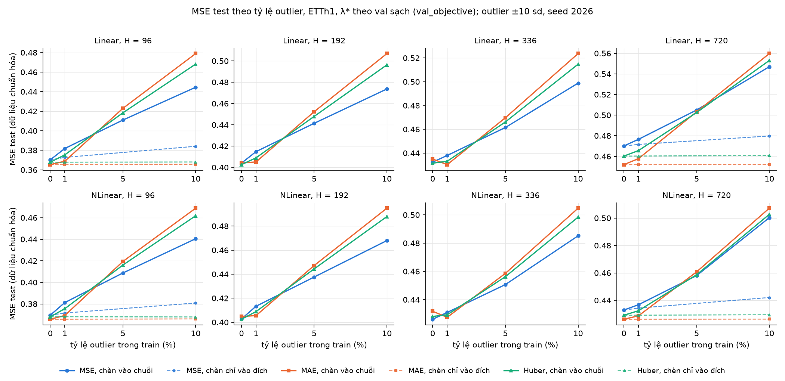
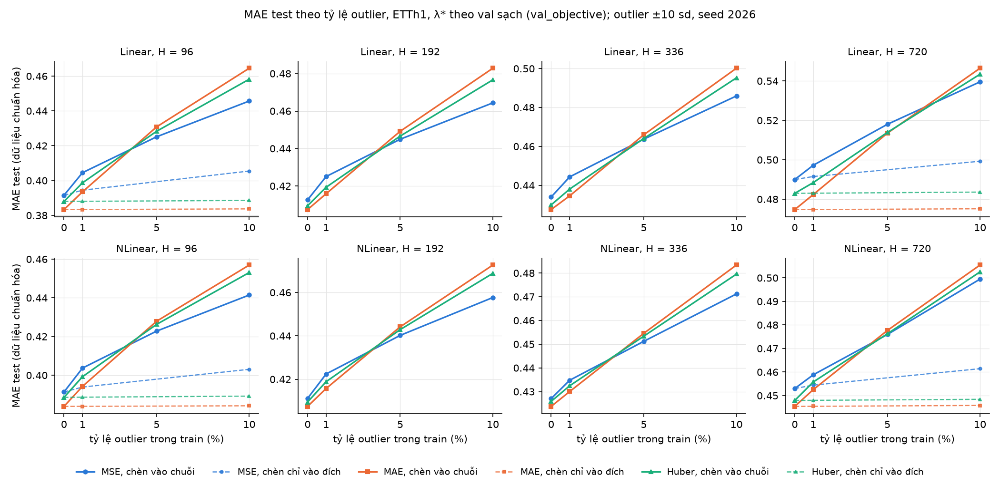

# Thí nghiệm outlier cho RQ2 (ETTh1), và hai phép kiểm SGD trên ETTm1

Ngày chạy: 07/10/2026. Nhiệm vụ: [NHIEM_VU_6.md](NHIEM_VU_6.md). Tiếp theo [BAO_CAO_SGD_B1_B4.md](BAO_CAO_SGD_B1_B4.md).

- Code: [`src/outliers.py`](../src/outliers.py) (A, C), [`tests/test_outliers.py`](../tests/test_outliers.py), [`scripts/runner.py`](../scripts/runner.py) (`--out`, `--outlier-mode`, `--outlier-rate`, `--outlier-seed`), [`scripts/select_lambda.py`](../scripts/select_lambda.py) (`--in`, `--out`), [`scripts/report_outliers.py`](../scripts/report_outliers.py) (mọi bảng và hình dưới đây); D: [`scripts/official_ltsf.py`](../scripts/official_ltsf.py), [`scripts/sgd_etth2.py`](../scripts/sgd_etth2.py).
- Số liệu:
  - B, C, B.5: [`results/outliers/lambda_path.csv`](../results/outliers/lambda_path.csv) (108 đường λ), [`results/outliers/results.csv`](../results/outliers/results.csv);
  - B.2: [`results/outliers/check_rate0/lambda_path.csv`](../results/outliers/check_rate0/lambda_path.csv);
  - D.1: [`results/outliers/d1_official/`](../results/outliers/d1_official/) (kèm log của code gốc); D.2: [`results/outliers/d2_lr/`](../results/outliers/d2_lr/);
  - bảng và hình: [`results/outliers/tables.md`](../results/outliers/tables.md), `summary.json`, `H2_outlier_robustness.png`, `H2_outlier_robustness_mae.png`.
- Máy: RTX 5060 Ti (B, C), CPU Intel (D), torch 2.14.0+cu130 (`.venv-gpu`), TF32 tắt. Cấu hình bộ giải giữ đúng grid (chế độ pha, chunk 16, dừng (a′) cho MAE, tol 1e-9 cho Huber, MSE dạng đóng, lưới λ như grid, warm start, fallback float64 theo h).
- Mọi dòng CSV có `git_commit` sạch: `3d5bfa2` (series 10%) hoặc `a81acb1` (mọi phần còn lại); `src/`, `runner.py`, `bench_5060ti.py` không đổi giữa hai commit.
- JSON của D ghi `cfb2b92` (157 file) hoặc `238f89b` (3 file). Có 3 file D.2 (lr 0,0002) ghi `238f89b-dirty`, viết lúc `scripts/report_outliers.py` mới tạo chưa commit; `sgd_etth2.py` không đổi giữa `238f89b` và `cfb2b92`.
- Test: 49 → **60, tất cả đạt** (`.venv-gpu/Scripts/python -m unittest discover -s tests -t .`).
- Thay đổi code: [NHAT_KY_THAY_DOI.md](NHAT_KY_THAY_DOI.md), mục 11.

Ký hiệu: "series" là chèn vào chuỗi gốc (Phần B), "target" là chèn chỉ vào đích (Phần C). λ* chọn trên **val sạch** theo metric val của chính mục tiêu (`val_objective`), trừ khi ghi khác. Δ = metric ở rate r − metric ở rate 0 (grid trên dữ liệu gốc, `results/results.csv`). Mọi MSE/MAE tính trên dữ liệu đã chuẩn hóa.

## 1. Kết luận

**Khi outlier nằm trong chuỗi gốc (xuất hiện ở cả x lẫn y), không mục tiêu nào bền vững; ở rate ≥ 5%, MSE lại suy giảm ít nhất. Khi outlier chỉ nằm ở đích, MAE và Huber gần như không đổi còn MSE suy giảm.**

- **Chèn vào chuỗi gốc, 0% → 10%** (8 ô mô hình × H, seed 2026):
  - MSE test tăng **+0,059 đến +0,077** với mục tiêu MSE, **+0,070 đến +0,101** với Huber, **+0,073 đến +0,114** với MAE.
  - MAE test tăng +0,044 đến +0,054 (MSE), +0,054 đến +0,070 (Huber), +0,060 đến +0,081 (MAE).
  - Mục tiêu MSE suy giảm ít nhất ở cả 8/8 ô, trên cả MSE test lẫn MAE test. MAE suy giảm nhiều nhất ở cả 8/8 ô.
- **Thứ hạng đổi theo rate.** Mục tiêu có MSE test thấp nhất trong ô:

  | rate | MSE | MAE | Huber |
  |---|---|---|---|
  | 0% | 1 | 4 | 3 |
  | 1% | 0 | **8** | 0 |
  | 5% | **7** | 0 | 1 |
  | 10% | **8** | 0 | 0 |

  Với MAE test, thứ tự giống hệt ở 1% và 10%. Chọn λ* theo `val_mse` cũng cho cùng kết quả ở 1%, 5%, 10%.
- **Với outlier trong chuỗi, λ* (chọn trên val sạch) về 0:** ở rate 5% và 10%, λ* = 0 ở cả 48/48 ô (2 mô hình × 4 H × 3 mục tiêu × 2 rate); ở 1% là 15/24 ô, các ô còn lại có λ* ≤ 1. Trên dữ liệu gốc, λ* lên tới 1e4–2e4 ở H = 720.
- **Chèn chỉ vào đích (H = 96, 720):** ở rate 10%, MSE test của MAE và Huber đổi **không quá 0,0005**; của MSE tăng **+0,009 đến +0,014**. Ở 1%, MAE và Huber đổi không quá 0,0001, MSE tăng +0,0014 đến +0,0025. Đây là hành vi bền vững mà lý thuyết hồi quy bền vững dự đoán cho outlier ở y; nó không còn khi outlier cũng nằm trong x (chèn vào chuỗi, khi đó 97–100% cửa sổ train có outlier trong x, xem mục 2).
- **Linear và NLinear cho cùng thứ hạng mục tiêu ở mọi rate.** NLinear suy giảm ít hơn Linear ở cả 12/12 cặp (H, mục tiêu) tại rate 10% (ví dụ H = 720, MAE: +0,081 so với +0,108).
- **Độ nhạy theo seed chèn (Linear, H = 96, seed 2026–2028):**
  - Rate 1%: độ lệch giữa seed tối đa 0,0029, nhỏ hơn nhiều khác biệt giữa mục tiêu (0,0120). Thứ tự MAE < Huber < MSE giữ ở cả 3 seed.
  - Rate 10%: độ lệch giữa seed lên tới **0,0148**, cùng cỡ khác biệt giữa mục tiêu (0,0214). MSE thấp nhất và MAE cao nhất ở cả 3 seed, nhưng ở seed 2027 MSE chỉ hơn Huber 0,0003. **Thứ tự MSE so với Huber ở 10% nằm trong nhiễu theo vị trí outlier**; MAE kém nhất thì ổn định.
- **D.1 (code gốc, DLinear ETTm1 H = 96, 5 seed, CPU):** 0,3018 ± 0,0010 (0,3008–0,3031), không seed nào dưới 0,300. Chênh với 20 seed của repo: +0,0002 [−0,0011; 0,0014] (Welch). Số công bố 0,299 không tái lập được bằng code gốc, giống trường hợp ETTh2; pipeline của repo không khác code gốc ở ô này.
- **D.2 (Linear ETTm1, lr gấp đôi, chọn trước):** với lr = 0,0002, Linear vẫn kém DLinear (lr gốc) có ý nghĩa trên test ở **4/4 H** (trên val 2/4). **Giả thuyết không đủ** để giải thích khoảng cách DLinear − Linear. Lần thử thêm lr = 0,0004 (không chọn trước, chỉ xem xu hướng): khoảng cách trên test hết ý nghĩa ở 3/4 H, còn ở H = 720 (+0,0060 [0,0024; 0,0097]).

## 2. Thiết kế chèn outlier (A.1)

- **Chuỗi:** train ETTh1 đã chuẩn hóa theo mean/std của **train sạch** (ddof = 0, như `load_ett`), kích thước [8640, 7]. **Scaler không tính lại sau khi chèn.**
- **Vùng cấm:** L = 336 hàng cuối của train, vì cửa sổ val bắt đầu lùi L hàng vào cuối train. Vùng được chèn: hàng 0–8303, tức 8304 × 7 = 58 128 điểm. Test `test_val_test_unchanged` ghép train đã chèn vào chuỗi đầy đủ, cắt lại val và test, và kiểm các cửa sổ x, y của val và test **trùng từng byte** với khi không chèn (H = 96, 720; rate 1%, 10%). Phép phản chứng `protect_last = 0` làm val thay đổi.
- **Cách chèn:** chọn đúng ⌊rate × 58 128⌋ điểm (hàng, kênh) không lặp bằng `numpy.random.default_rng(seed)`, cộng ±10 (dấu ngẫu nhiên, xác suất 1/2), tức ±10 độ lệch chuẩn của kênh. Cửa sổ train cắt từ chuỗi đã chèn bằng `make_dataset`, nên một điểm outlier xuất hiện ở nhiều cửa sổ, cả trong x lẫn y. Vị trí outlier không phụ thuộc H.
- **Chèn chỉ vào đích (C):** chọn ⌊rate × số phần tử Y⌋ phần tử (cửa sổ, kênh, bước h) của Y train, cộng ±10; X giữ nguyên.

Tỷ lệ cửa sổ = tỷ lệ cửa sổ train (một cửa sổ cho mỗi kênh, như `make_dataset`) có ít nhất một outlier trong x, trong y.

| Chế độ | rate | seed | H | số điểm chèn | cửa sổ có outlier trong x | trong y |
|---|---|---|---|---|---|---|
| series | 1% | 2026 | 96 | 581 | 0,966 | 0,592 |
| series | 1% | 2026 | 192 | 581 | 0,971 | 0,842 |
| series | 1% | 2026 | 336 | 581 | 0,972 | 0,957 |
| series | 1% | 2026 | 720 | 581 | 0,972 | 1,000 |
| series | 5% | 2026 | 96 | 2906 | 1,000 | 0,962 |
| series | 5% | 2026 | 192 | 2906 | 1,000 | 0,979 |
| series | 5% | 2026 | 336 | 2906 | 1,000 | 0,997 |
| series | 5% | 2026 | 720 | 2906 | 1,000 | 1,000 |
| series | 10% | 2026 | 96 | 5812 | 1,000 | 0,970 |
| series | 10% | 2026 | 192 | 5812 | 1,000 | 0,981 |
| series | 10% | 2026 | 336 | 5812 | 1,000 | 0,999 |
| series | 10% | 2026 | 720 | 5812 | 1,000 | 1,000 |
| series | 1% | 2027 | 96 | 581 | 0,969 | 0,617 |
| series | 10% | 2027 | 96 | 5812 | 1,000 | 0,969 |
| series | 1% | 2028 | 96 | 581 | 0,974 | 0,608 |
| series | 10% | 2028 | 96 | 5812 | 1,000 | 0,969 |
| target | 1% | 2026 | 96 | 55164 | 0,000 | 0,620 |
| target | 1% | 2026 | 720 | 382284 | 0,000 | 0,999 |
| target | 10% | 2026 | 96 | 551644 | 0,000 | 1,000 |
| target | 10% | 2026 | 720 | 3822840 | 0,000 | 1,000 |

## 3. Kiểm trước và thời gian

- **B.2:** runner với rate = 0 (chế độ series) cho Linear, ETTh1, H = 96, MSE và MAE: **154/154 dòng trùng `lambda_path.csv` tuyệt đối** (chênh 0 ở mọi cột metric, cùng số vòng IRLS), tốt hơn ngưỡng 1e-10 / 1e-8.
- **B.3:** `--dry-run` ước lượng 2,25 giờ mỗi rate. Đo thật đường MAE đầu tiên (rate 10%, H = 96): 3,5 phút mỗi mô hình, nhanh hơn trên dữ liệu gốc (khoảng 5 phút). Không cắt gì.
- **Thời gian thực (GPU):** B rate 10% 1 giờ 32 phút, 1% 2 giờ 11 phút, 5% 1 giờ 44 phút; B.5 17 phút. **Phần B tổng cộng 5 giờ 44 phút**, trong ngân sách 10 giờ. C: 2 giờ 46 phút. Chạy theo thứ tự 10% → 1% → 5% → C → B.5.
- **D (CPU, song song với B):** D.1 36 phút (10:18–10:54), D.2 lr 0,0002 22 phút (10:18–10:40), lr 0,0004 17 phút (10:40–10:57). Mỗi phép kiểm dưới 60 phút.
- **Không chạm điểm dừng nào ở mục 7:** test đạt; val, test không đổi; B.2 trùng; không `RuntimeError: J tăng`, không dòng `converged = False` nào trong 108 đường λ, không bước h nào cần fallback float64; D.1 không có seed dưới 0,300.

## 4. Bảng chính

### Bảng chính: chèn vào chuỗi gốc (seed 2026), λ* theo val_objective

Δ so với rate 0 (dữ liệu gốc, cùng cách chọn λ*). λ* chọn trên val sạch.

| Mô hình | H | Mục tiêu | rate | λ* | MSE test | MAE test | Δ MSE | Δ MAE |
|---|---|---|---|---|---|---|---|---|
| Linear | 96 | MSE | 0% | 0 (đầu mút) | 0,3702 | 0,3915 | — | — |
| Linear | 96 | MSE | 1% | 0 (đầu mút) | 0,3818 | 0,4045 | +0,0116 | +0,0130 |
| Linear | 96 | MSE | 5% | 0 (đầu mút) | 0,4110 | 0,4251 | +0,0407 | +0,0336 |
| Linear | 96 | MSE | 10% | 0 (đầu mút) | 0,4445 | 0,4457 | +0,0743 | +0,0541 |
| Linear | 96 | MAE | 0% | 0 (đầu mút) | 0,3653 | 0,3833 | — | — |
| Linear | 96 | MAE | 1% | 0 (đầu mút) | 0,3688 | 0,3935 | +0,0034 | +0,0102 |
| Linear | 96 | MAE | 5% | 0 (đầu mút) | 0,4230 | 0,4308 | +0,0576 | +0,0475 |
| Linear | 96 | MAE | 10% | 0 (đầu mút) | 0,4790 | 0,4645 | +0,1136 | +0,0812 |
| Linear | 96 | Huber | 0% | 3 | 0,3678 | 0,3880 | — | — |
| Linear | 96 | Huber | 1% | 0,3333 | 0,3754 | 0,3987 | +0,0076 | +0,0107 |
| Linear | 96 | Huber | 5% | 0 (đầu mút) | 0,4184 | 0,4283 | +0,0506 | +0,0403 |
| Linear | 96 | Huber | 10% | 0 (đầu mút) | 0,4682 | 0,4582 | +0,1004 | +0,0702 |
| Linear | 192 | MSE | 0% | 223,9 | 0,4040 | 0,4126 | — | — |
| Linear | 192 | MSE | 1% | 0 (đầu mút) | 0,4148 | 0,4250 | +0,0108 | +0,0124 |
| Linear | 192 | MSE | 5% | 0 (đầu mút) | 0,4414 | 0,4449 | +0,0374 | +0,0324 |
| Linear | 192 | MSE | 10% | 0 (đầu mút) | 0,4736 | 0,4644 | +0,0697 | +0,0518 |
| Linear | 192 | MAE | 0% | 300 | 0,4041 | 0,4074 | — | — |
| Linear | 192 | MAE | 1% | 0 (đầu mút) | 0,4051 | 0,4159 | +0,0010 | +0,0085 |
| Linear | 192 | MAE | 5% | 0 (đầu mút) | 0,4523 | 0,4492 | +0,0482 | +0,0418 |
| Linear | 192 | MAE | 10% | 0 (đầu mút) | 0,5069 | 0,4829 | +0,1028 | +0,0755 |
| Linear | 192 | Huber | 0% | 100 | 0,4026 | 0,4094 | — | — |
| Linear | 192 | Huber | 1% | 0,3333 | 0,4090 | 0,4193 | +0,0064 | +0,0099 |
| Linear | 192 | Huber | 5% | 0 (đầu mút) | 0,4479 | 0,4466 | +0,0453 | +0,0372 |
| Linear | 192 | Huber | 10% | 0 (đầu mút) | 0,4963 | 0,4767 | +0,0937 | +0,0672 |
| Linear | 336 | MSE | 0% | 1995 | 0,4324 | 0,4340 | — | — |
| Linear | 336 | MSE | 1% | 0 (đầu mút) | 0,4380 | 0,4443 | +0,0056 | +0,0104 |
| Linear | 336 | MSE | 5% | 0 (đầu mút) | 0,4615 | 0,4637 | +0,0291 | +0,0297 |
| Linear | 336 | MSE | 10% | 0 (đầu mút) | 0,4988 | 0,4859 | +0,0665 | +0,0519 |
| Linear | 336 | MAE | 0% | 1000 | 0,4350 | 0,4275 | — | — |
| Linear | 336 | MAE | 1% | 0 (đầu mút) | 0,4303 | 0,4346 | −0,0047 | +0,0071 |
| Linear | 336 | MAE | 5% | 0 (đầu mút) | 0,4697 | 0,4660 | +0,0348 | +0,0385 |
| Linear | 336 | MAE | 10% | 0 (đầu mút) | 0,5237 | 0,5002 | +0,0887 | +0,0727 |
| Linear | 336 | Huber | 0% | 1000 | 0,4315 | 0,4299 | — | — |
| Linear | 336 | Huber | 1% | 0,3333 | 0,4331 | 0,4381 | +0,0016 | +0,0081 |
| Linear | 336 | Huber | 5% | 0 (đầu mút) | 0,4662 | 0,4641 | +0,0347 | +0,0341 |
| Linear | 336 | Huber | 10% | 0 (đầu mút) | 0,5148 | 0,4952 | +0,0833 | +0,0653 |
| Linear | 720 | MSE | 0% | 1,778e+04 | 0,4701 | 0,4900 | — | — |
| Linear | 720 | MSE | 1% | 0 (đầu mút) | 0,4765 | 0,4972 | +0,0064 | +0,0073 |
| Linear | 720 | MSE | 5% | 0 (đầu mút) | 0,5050 | 0,5180 | +0,0349 | +0,0280 |
| Linear | 720 | MSE | 10% | 0 (đầu mút) | 0,5470 | 0,5396 | +0,0769 | +0,0496 |
| Linear | 720 | MAE | 0% | 1e+04 | 0,4520 | 0,4747 | — | — |
| Linear | 720 | MAE | 1% | 0 (đầu mút) | 0,4578 | 0,4824 | +0,0058 | +0,0076 |
| Linear | 720 | MAE | 5% | 0 (đầu mút) | 0,5032 | 0,5135 | +0,0512 | +0,0388 |
| Linear | 720 | MAE | 10% | 0 (đầu mút) | 0,5597 | 0,5465 | +0,1078 | +0,0717 |
| Linear | 720 | Huber | 0% | 1e+04 | 0,4603 | 0,4830 | — | — |
| Linear | 720 | Huber | 1% | 1 | 0,4656 | 0,4884 | +0,0053 | +0,0055 |
| Linear | 720 | Huber | 5% | 0 (đầu mút) | 0,5025 | 0,5139 | +0,0423 | +0,0309 |
| Linear | 720 | Huber | 10% | 0 (đầu mút) | 0,5530 | 0,5434 | +0,0928 | +0,0604 |
| NLinear | 96 | MSE | 0% | 1413 | 0,3695 | 0,3913 | — | — |
| NLinear | 96 | MSE | 1% | 0 (đầu mút) | 0,3812 | 0,4037 | +0,0117 | +0,0124 |
| NLinear | 96 | MSE | 5% | 0 (đầu mút) | 0,4087 | 0,4228 | +0,0392 | +0,0315 |
| NLinear | 96 | MSE | 10% | 0 (đầu mút) | 0,4405 | 0,4415 | +0,0710 | +0,0501 |
| NLinear | 96 | MAE | 0% | 300 | 0,3657 | 0,3839 | — | — |
| NLinear | 96 | MAE | 1% | 0,1111 | 0,3692 | 0,3942 | +0,0035 | +0,0104 |
| NLinear | 96 | MAE | 5% | 0 (đầu mút) | 0,4194 | 0,4279 | +0,0537 | +0,0440 |
| NLinear | 96 | MAE | 10% | 0 (đầu mút) | 0,4688 | 0,4569 | +0,1031 | +0,0731 |
| NLinear | 96 | Huber | 0% | 300 | 0,3679 | 0,3886 | — | — |
| NLinear | 96 | Huber | 1% | 0,3333 | 0,3755 | 0,3992 | +0,0076 | +0,0107 |
| NLinear | 96 | Huber | 5% | 0 (đầu mút) | 0,4161 | 0,4263 | +0,0481 | +0,0377 |
| NLinear | 96 | Huber | 10% | 0 (đầu mút) | 0,4618 | 0,4531 | +0,0939 | +0,0645 |
| NLinear | 192 | MSE | 0% | 2512 | 0,4027 | 0,4112 | — | — |
| NLinear | 192 | MSE | 1% | 0 (đầu mút) | 0,4133 | 0,4224 | +0,0105 | +0,0113 |
| NLinear | 192 | MSE | 5% | 0 (đầu mút) | 0,4376 | 0,4402 | +0,0349 | +0,0291 |
| NLinear | 192 | MSE | 10% | 0 (đầu mút) | 0,4680 | 0,4577 | +0,0652 | +0,0465 |
| NLinear | 192 | MAE | 0% | 1000 | 0,4048 | 0,4075 | — | — |
| NLinear | 192 | MAE | 1% | 0 (đầu mút) | 0,4056 | 0,4157 | +0,0007 | +0,0082 |
| NLinear | 192 | MAE | 5% | 0 (đầu mút) | 0,4472 | 0,4442 | +0,0424 | +0,0367 |
| NLinear | 192 | MAE | 10% | 0 (đầu mút) | 0,4949 | 0,4727 | +0,0901 | +0,0652 |
| NLinear | 192 | Huber | 0% | 1000 | 0,4025 | 0,4095 | — | — |
| NLinear | 192 | Huber | 1% | 0,3333 | 0,4089 | 0,4189 | +0,0063 | +0,0094 |
| NLinear | 192 | Huber | 5% | 0 (đầu mút) | 0,4444 | 0,4429 | +0,0419 | +0,0334 |
| NLinear | 192 | Huber | 10% | 0 (đầu mút) | 0,4879 | 0,4688 | +0,0854 | +0,0593 |
| NLinear | 336 | MSE | 0% | 8913 | 0,4261 | 0,4270 | — | — |
| NLinear | 336 | MSE | 1% | 0 (đầu mút) | 0,4309 | 0,4348 | +0,0048 | +0,0078 |
| NLinear | 336 | MSE | 5% | 0 (đầu mút) | 0,4507 | 0,4512 | +0,0246 | +0,0242 |
| NLinear | 336 | MSE | 10% | 0 (đầu mút) | 0,4852 | 0,4712 | +0,0591 | +0,0442 |
| NLinear | 336 | MAE | 0% | 3000 | 0,4317 | 0,4237 | — | — |
| NLinear | 336 | MAE | 1% | 0 (đầu mút) | 0,4275 | 0,4300 | −0,0042 | +0,0063 |
| NLinear | 336 | MAE | 5% | 0 (đầu mút) | 0,4586 | 0,4546 | +0,0268 | +0,0308 |
| NLinear | 336 | MAE | 10% | 0 (đầu mút) | 0,5047 | 0,4834 | +0,0730 | +0,0596 |
| NLinear | 336 | Huber | 0% | 3000 | 0,4281 | 0,4259 | — | — |
| NLinear | 336 | Huber | 1% | 1 | 0,4293 | 0,4324 | +0,0012 | +0,0066 |
| NLinear | 336 | Huber | 5% | 0 (đầu mút) | 0,4562 | 0,4534 | +0,0281 | +0,0275 |
| NLinear | 336 | Huber | 10% | 0 (đầu mút) | 0,4984 | 0,4796 | +0,0703 | +0,0537 |
| NLinear | 720 | MSE | 0% | 1,995e+04 | 0,4329 | 0,4530 | — | — |
| NLinear | 720 | MSE | 1% | 0 (đầu mút) | 0,4368 | 0,4588 | +0,0039 | +0,0058 |
| NLinear | 720 | MSE | 5% | 0 (đầu mút) | 0,4580 | 0,4759 | +0,0251 | +0,0230 |
| NLinear | 720 | MSE | 10% | 0 (đầu mút) | 0,5003 | 0,4995 | +0,0673 | +0,0465 |
| NLinear | 720 | MAE | 0% | 1e+04 | 0,4262 | 0,4454 | — | — |
| NLinear | 720 | MAE | 1% | 0 (đầu mút) | 0,4287 | 0,4525 | +0,0025 | +0,0071 |
| NLinear | 720 | MAE | 5% | 0 (đầu mút) | 0,4607 | 0,4777 | +0,0345 | +0,0323 |
| NLinear | 720 | MAE | 10% | 0 (đầu mút) | 0,5072 | 0,5055 | +0,0810 | +0,0601 |
| NLinear | 720 | Huber | 0% | 3000 | 0,4291 | 0,4479 | — | — |
| NLinear | 720 | Huber | 1% | 0,3333 | 0,4324 | 0,4558 | +0,0033 | +0,0079 |
| NLinear | 720 | Huber | 5% | 0 (đầu mút) | 0,4586 | 0,4762 | +0,0295 | +0,0283 |
| NLinear | 720 | Huber | 10% | 0 (đầu mút) | 0,5027 | 0,5025 | +0,0736 | +0,0546 |

### Bảng phụ: như bảng chính nhưng λ* theo val_mse

Δ so với rate 0 (dữ liệu gốc, cùng cách chọn λ*). λ* chọn trên val sạch.

| Mô hình | H | Mục tiêu | rate | λ* | MSE test | MAE test | Δ MSE | Δ MAE |
|---|---|---|---|---|---|---|---|---|
| Linear | 96 | MSE | 0% | 0 (đầu mút) | 0,3702 | 0,3915 | — | — |
| Linear | 96 | MSE | 1% | 0 (đầu mút) | 0,3818 | 0,4045 | +0,0116 | +0,0130 |
| Linear | 96 | MSE | 5% | 0 (đầu mút) | 0,4110 | 0,4251 | +0,0407 | +0,0336 |
| Linear | 96 | MSE | 10% | 0 (đầu mút) | 0,4445 | 0,4457 | +0,0743 | +0,0541 |
| Linear | 96 | MAE | 0% | 0 (đầu mút) | 0,3653 | 0,3833 | — | — |
| Linear | 96 | MAE | 1% | 0 (đầu mút) | 0,3688 | 0,3935 | +0,0034 | +0,0102 |
| Linear | 96 | MAE | 5% | 0 (đầu mút) | 0,4230 | 0,4308 | +0,0576 | +0,0475 |
| Linear | 96 | MAE | 10% | 0 (đầu mút) | 0,4790 | 0,4645 | +0,1136 | +0,0812 |
| Linear | 96 | Huber | 0% | 1 | 0,3678 | 0,3880 | — | — |
| Linear | 96 | Huber | 1% | 0,3333 | 0,3754 | 0,3987 | +0,0076 | +0,0107 |
| Linear | 96 | Huber | 5% | 0 (đầu mút) | 0,4184 | 0,4283 | +0,0506 | +0,0403 |
| Linear | 96 | Huber | 10% | 0 (đầu mút) | 0,4682 | 0,4582 | +0,1004 | +0,0702 |
| Linear | 192 | MSE | 0% | 223,9 | 0,4040 | 0,4126 | — | — |
| Linear | 192 | MSE | 1% | 0 (đầu mút) | 0,4148 | 0,4250 | +0,0108 | +0,0124 |
| Linear | 192 | MSE | 5% | 0 (đầu mút) | 0,4414 | 0,4449 | +0,0374 | +0,0324 |
| Linear | 192 | MSE | 10% | 0 (đầu mút) | 0,4736 | 0,4644 | +0,0697 | +0,0518 |
| Linear | 192 | MAE | 0% | 1000 | 0,4031 | 0,4071 | — | — |
| Linear | 192 | MAE | 1% | 0 (đầu mút) | 0,4051 | 0,4159 | +0,0020 | +0,0088 |
| Linear | 192 | MAE | 5% | 0 (đầu mút) | 0,4523 | 0,4492 | +0,0492 | +0,0421 |
| Linear | 192 | MAE | 10% | 0 (đầu mút) | 0,5069 | 0,4829 | +0,1038 | +0,0758 |
| Linear | 192 | Huber | 0% | 100 | 0,4026 | 0,4094 | — | — |
| Linear | 192 | Huber | 1% | 0,3333 | 0,4090 | 0,4193 | +0,0064 | +0,0099 |
| Linear | 192 | Huber | 5% | 0 (đầu mút) | 0,4479 | 0,4466 | +0,0453 | +0,0372 |
| Linear | 192 | Huber | 10% | 0 (đầu mút) | 0,4963 | 0,4767 | +0,0937 | +0,0672 |
| Linear | 336 | MSE | 0% | 1995 | 0,4324 | 0,4340 | — | — |
| Linear | 336 | MSE | 1% | 0 (đầu mút) | 0,4380 | 0,4443 | +0,0056 | +0,0104 |
| Linear | 336 | MSE | 5% | 0 (đầu mút) | 0,4615 | 0,4637 | +0,0291 | +0,0297 |
| Linear | 336 | MSE | 10% | 0 (đầu mút) | 0,4988 | 0,4859 | +0,0665 | +0,0519 |
| Linear | 336 | MAE | 0% | 3e+04 | 0,4302 | 0,4328 | — | — |
| Linear | 336 | MAE | 1% | 0 (đầu mút) | 0,4303 | 0,4346 | +0,0001 | +0,0018 |
| Linear | 336 | MAE | 5% | 0 (đầu mút) | 0,4697 | 0,4660 | +0,0396 | +0,0332 |
| Linear | 336 | MAE | 10% | 0 (đầu mút) | 0,5237 | 0,5002 | +0,0935 | +0,0674 |
| Linear | 336 | Huber | 0% | 3000 | 0,4304 | 0,4306 | — | — |
| Linear | 336 | Huber | 1% | 0,3333 | 0,4331 | 0,4381 | +0,0027 | +0,0075 |
| Linear | 336 | Huber | 5% | 0 (đầu mút) | 0,4662 | 0,4641 | +0,0358 | +0,0335 |
| Linear | 336 | Huber | 10% | 0 (đầu mút) | 0,5148 | 0,4952 | +0,0843 | +0,0646 |
| Linear | 720 | MSE | 0% | 1,778e+04 | 0,4701 | 0,4900 | — | — |
| Linear | 720 | MSE | 1% | 0 (đầu mút) | 0,4765 | 0,4972 | +0,0064 | +0,0073 |
| Linear | 720 | MSE | 5% | 0 (đầu mút) | 0,5050 | 0,5180 | +0,0349 | +0,0280 |
| Linear | 720 | MSE | 10% | 0 (đầu mút) | 0,5470 | 0,5396 | +0,0769 | +0,0496 |
| Linear | 720 | MAE | 0% | 3e+04 | 0,4553 | 0,4802 | — | — |
| Linear | 720 | MAE | 1% | 0 (đầu mút) | 0,4578 | 0,4824 | +0,0024 | +0,0022 |
| Linear | 720 | MAE | 5% | 0 (đầu mút) | 0,5032 | 0,5135 | +0,0479 | +0,0333 |
| Linear | 720 | MAE | 10% | 0 (đầu mút) | 0,5597 | 0,5465 | +0,1044 | +0,0663 |
| Linear | 720 | Huber | 0% | 1e+04 | 0,4603 | 0,4830 | — | — |
| Linear | 720 | Huber | 1% | 1 | 0,4656 | 0,4884 | +0,0053 | +0,0055 |
| Linear | 720 | Huber | 5% | 0 (đầu mút) | 0,5025 | 0,5139 | +0,0423 | +0,0309 |
| Linear | 720 | Huber | 10% | 0 (đầu mút) | 0,5530 | 0,5434 | +0,0928 | +0,0604 |
| NLinear | 96 | MSE | 0% | 1413 | 0,3695 | 0,3913 | — | — |
| NLinear | 96 | MSE | 1% | 0 (đầu mút) | 0,3812 | 0,4037 | +0,0117 | +0,0124 |
| NLinear | 96 | MSE | 5% | 0 (đầu mút) | 0,4087 | 0,4228 | +0,0392 | +0,0315 |
| NLinear | 96 | MSE | 10% | 0 (đầu mút) | 0,4405 | 0,4415 | +0,0710 | +0,0501 |
| NLinear | 96 | MAE | 0% | 3000 | 0,3638 | 0,3840 | — | — |
| NLinear | 96 | MAE | 1% | 0 (đầu mút) | 0,3692 | 0,3942 | +0,0055 | +0,0103 |
| NLinear | 96 | MAE | 5% | 0 (đầu mút) | 0,4194 | 0,4279 | +0,0557 | +0,0439 |
| NLinear | 96 | MAE | 10% | 0 (đầu mút) | 0,4688 | 0,4569 | +0,1051 | +0,0730 |
| NLinear | 96 | Huber | 0% | 1000 | 0,3674 | 0,3887 | — | — |
| NLinear | 96 | Huber | 1% | 0,3333 | 0,3755 | 0,3992 | +0,0081 | +0,0106 |
| NLinear | 96 | Huber | 5% | 0 (đầu mút) | 0,4161 | 0,4263 | +0,0487 | +0,0376 |
| NLinear | 96 | Huber | 10% | 0 (đầu mút) | 0,4618 | 0,4531 | +0,0944 | +0,0644 |
| NLinear | 192 | MSE | 0% | 2512 | 0,4027 | 0,4112 | — | — |
| NLinear | 192 | MSE | 1% | 0 (đầu mút) | 0,4133 | 0,4224 | +0,0105 | +0,0113 |
| NLinear | 192 | MSE | 5% | 0 (đầu mút) | 0,4376 | 0,4402 | +0,0349 | +0,0291 |
| NLinear | 192 | MSE | 10% | 0 (đầu mút) | 0,4680 | 0,4577 | +0,0652 | +0,0465 |
| NLinear | 192 | MAE | 0% | 1e+04 | 0,4026 | 0,4091 | — | — |
| NLinear | 192 | MAE | 1% | 0 (đầu mút) | 0,4056 | 0,4157 | +0,0030 | +0,0066 |
| NLinear | 192 | MAE | 5% | 0 (đầu mút) | 0,4472 | 0,4442 | +0,0446 | +0,0351 |
| NLinear | 192 | MAE | 10% | 0 (đầu mút) | 0,4949 | 0,4727 | +0,0923 | +0,0636 |
| NLinear | 192 | Huber | 0% | 1000 | 0,4025 | 0,4095 | — | — |
| NLinear | 192 | Huber | 1% | 0,3333 | 0,4089 | 0,4189 | +0,0063 | +0,0094 |
| NLinear | 192 | Huber | 5% | 0 (đầu mút) | 0,4444 | 0,4429 | +0,0419 | +0,0334 |
| NLinear | 192 | Huber | 10% | 0 (đầu mút) | 0,4879 | 0,4688 | +0,0854 | +0,0593 |
| NLinear | 336 | MSE | 0% | 8913 | 0,4261 | 0,4270 | — | — |
| NLinear | 336 | MSE | 1% | 0 (đầu mút) | 0,4309 | 0,4348 | +0,0048 | +0,0078 |
| NLinear | 336 | MSE | 5% | 0 (đầu mút) | 0,4507 | 0,4512 | +0,0246 | +0,0242 |
| NLinear | 336 | MSE | 10% | 0 (đầu mút) | 0,4852 | 0,4712 | +0,0591 | +0,0442 |
| NLinear | 336 | MAE | 0% | 3e+04 | 0,4290 | 0,4287 | — | — |
| NLinear | 336 | MAE | 1% | 0 (đầu mút) | 0,4275 | 0,4300 | −0,0015 | +0,0014 |
| NLinear | 336 | MAE | 5% | 0 (đầu mút) | 0,4586 | 0,4546 | +0,0296 | +0,0259 |
| NLinear | 336 | MAE | 10% | 0 (đầu mút) | 0,5047 | 0,4834 | +0,0758 | +0,0547 |
| NLinear | 336 | Huber | 0% | 1e+04 | 0,4280 | 0,4286 | — | — |
| NLinear | 336 | Huber | 1% | 1 | 0,4293 | 0,4324 | +0,0013 | +0,0039 |
| NLinear | 336 | Huber | 5% | 0 (đầu mút) | 0,4562 | 0,4534 | +0,0282 | +0,0248 |
| NLinear | 336 | Huber | 10% | 0 (đầu mút) | 0,4984 | 0,4796 | +0,0704 | +0,0510 |
| NLinear | 720 | MSE | 0% | 1,995e+04 | 0,4329 | 0,4530 | — | — |
| NLinear | 720 | MSE | 1% | 0 (đầu mút) | 0,4368 | 0,4588 | +0,0039 | +0,0058 |
| NLinear | 720 | MSE | 5% | 0 (đầu mút) | 0,4580 | 0,4759 | +0,0251 | +0,0230 |
| NLinear | 720 | MSE | 10% | 0 (đầu mút) | 0,5003 | 0,4995 | +0,0673 | +0,0465 |
| NLinear | 720 | MAE | 0% | 3e+04 | 0,4282 | 0,4504 | — | — |
| NLinear | 720 | MAE | 1% | 0 (đầu mút) | 0,4287 | 0,4525 | +0,0004 | +0,0021 |
| NLinear | 720 | MAE | 5% | 0 (đầu mút) | 0,4607 | 0,4777 | +0,0325 | +0,0272 |
| NLinear | 720 | MAE | 10% | 0 (đầu mút) | 0,5072 | 0,5055 | +0,0789 | +0,0550 |
| NLinear | 720 | Huber | 0% | 1e+04 | 0,4295 | 0,4509 | — | — |
| NLinear | 720 | Huber | 1% | 0,3333 | 0,4324 | 0,4558 | +0,0029 | +0,0049 |
| NLinear | 720 | Huber | 5% | 0 (đầu mút) | 0,4586 | 0,4762 | +0,0291 | +0,0254 |
| NLinear | 720 | Huber | 10% | 0 (đầu mút) | 0,5027 | 0,5025 | +0,0732 | +0,0517 |

### Tóm tắt theo mục tiêu (series, seed 2026, val_objective)

Suy giảm = MSE (MAE) test ở rate 10% − ở rate 0. "Tốt nhất" = mục tiêu có MSE test thấp nhất trong ô.

| Mô hình | H | suy giảm MSE: MSE / MAE / Huber | suy giảm MAE: MSE / MAE / Huber | tốt nhất (MSE test) ở 0% / 1% / 5% / 10% |
|---|---|---|---|---|
| Linear | 96 | +0,0743 / +0,1136 / +0,1004 | +0,0541 / +0,0812 / +0,0702 | MAE / MAE / MSE / MSE |
| Linear | 192 | +0,0697 / +0,1028 / +0,0937 | +0,0518 / +0,0755 / +0,0672 | Huber / MAE / MSE / MSE |
| Linear | 336 | +0,0665 / +0,0887 / +0,0833 | +0,0519 / +0,0727 / +0,0653 | Huber / MAE / MSE / MSE |
| Linear | 720 | +0,0769 / +0,1078 / +0,0928 | +0,0496 / +0,0717 / +0,0604 | MAE / MAE / Huber / MSE |
| NLinear | 96 | +0,0710 / +0,1031 / +0,0939 | +0,0501 / +0,0731 / +0,0645 | MAE / MAE / MSE / MSE |
| NLinear | 192 | +0,0652 / +0,0901 / +0,0854 | +0,0465 / +0,0652 / +0,0593 | Huber / MAE / MSE / MSE |
| NLinear | 336 | +0,0591 / +0,0730 / +0,0703 | +0,0442 / +0,0596 / +0,0537 | MSE / MAE / MSE / MSE |
| NLinear | 720 | +0,0673 / +0,0810 / +0,0736 | +0,0465 / +0,0601 / +0,0546 | MAE / MAE / MSE / MSE |

## 5. Hình H2





Mỗi ô là một (mô hình, H). Trục hoành: tỷ lệ outlier trong train (%); trục tung: MSE (hình trên) hoặc MAE (hình dưới) test trên dữ liệu chuẩn hóa. Ba màu cho ba mục tiêu (λ* theo val sạch, `val_objective`). Nét liền: chèn vào chuỗi gốc (0, 1, 5, 10%); nét đứt: chèn chỉ vào đích (0, 1, 10%, chỉ ở H = 96, 720). Điểm 0% chung cho hai chế độ (grid trên dữ liệu gốc).

## 6. Phần C, độ nhạy theo seed, Phần D

### C. Chèn vào chuỗi gốc so với chèn chỉ vào đích (seed 2026, val_objective)

| Mô hình | H | Mục tiêu | rate | series: MSE / MAE test | target: MSE / MAE test | Δ MSE so với 0%: series / target |
|---|---|---|---|---|---|---|
| Linear | 96 | MSE | 1% | 0,3818 / 0,4045 | 0,3727 / 0,3945 | +0,0116 / +0,0025 |
| Linear | 96 | MSE | 10% | 0,4445 / 0,4457 | 0,3841 / 0,4055 | +0,0743 / +0,0139 |
| Linear | 96 | MAE | 1% | 0,3688 / 0,3935 | 0,3654 / 0,3834 | +0,0034 / +0,0001 |
| Linear | 96 | MAE | 10% | 0,4790 / 0,4645 | 0,3657 / 0,3837 | +0,1136 / +0,0004 |
| Linear | 96 | Huber | 1% | 0,3754 / 0,3987 | 0,3678 / 0,3881 | +0,0076 / +0,0001 |
| Linear | 96 | Huber | 10% | 0,4682 / 0,4582 | 0,3680 / 0,3886 | +0,1004 / +0,0003 |
| Linear | 720 | MSE | 1% | 0,4765 / 0,4972 | 0,4716 / 0,4915 | +0,0064 / +0,0015 |
| Linear | 720 | MSE | 10% | 0,5470 / 0,5396 | 0,4798 / 0,4993 | +0,0769 / +0,0097 |
| Linear | 720 | MAE | 1% | 0,4578 / 0,4824 | 0,4520 / 0,4748 | +0,0058 / +0,0000 |
| Linear | 720 | MAE | 10% | 0,5597 / 0,5465 | 0,4521 / 0,4751 | +0,1078 / +0,0002 |
| Linear | 720 | Huber | 1% | 0,4656 / 0,4884 | 0,4603 / 0,4830 | +0,0053 / +0,0001 |
| Linear | 720 | Huber | 10% | 0,5530 / 0,5434 | 0,4608 / 0,4836 | +0,0928 / +0,0005 |
| NLinear | 96 | MSE | 1% | 0,3812 / 0,4037 | 0,3715 / 0,3939 | +0,0117 / +0,0020 |
| NLinear | 96 | MSE | 10% | 0,4405 / 0,4415 | 0,3808 / 0,4031 | +0,0710 / +0,0113 |
| NLinear | 96 | MAE | 1% | 0,3692 / 0,3942 | 0,3658 / 0,3839 | +0,0035 / +0,0000 |
| NLinear | 96 | MAE | 10% | 0,4688 / 0,4569 | 0,3660 / 0,3842 | +0,1031 / +0,0003 |
| NLinear | 96 | Huber | 1% | 0,3755 / 0,3992 | 0,3680 / 0,3886 | +0,0076 / +0,0001 |
| NLinear | 96 | Huber | 10% | 0,4618 / 0,4531 | 0,3679 / 0,3892 | +0,0939 / −0,0001 |
| NLinear | 720 | MSE | 1% | 0,4368 / 0,4588 | 0,4343 / 0,4544 | +0,0039 / +0,0014 |
| NLinear | 720 | MSE | 10% | 0,5003 / 0,4995 | 0,4420 / 0,4614 | +0,0673 / +0,0091 |
| NLinear | 720 | MAE | 1% | 0,4287 / 0,4525 | 0,4262 / 0,4454 | +0,0025 / +0,0000 |
| NLinear | 720 | MAE | 10% | 0,5072 / 0,5055 | 0,4263 / 0,4458 | +0,0810 / +0,0001 |
| NLinear | 720 | Huber | 1% | 0,4324 / 0,4558 | 0,4292 / 0,4480 | +0,0033 / +0,0001 |
| NLinear | 720 | Huber | 10% | 0,5027 / 0,5025 | 0,4295 / 0,4484 | +0,0736 / +0,0004 |

### B.5. Độ nhạy theo seed chèn (Linear, H = 96, series, val_objective)

Độ lệch giữa seed = max − min của MSE test trên 3 seed (2026–2028). Khác biệt giữa mục tiêu = max − min của trung bình 3 seed giữa ba mục tiêu.

| rate | Mục tiêu | MSE test theo seed 2026 / 2027 / 2028 | TB ± sd | max − min | MAE test: TB ± sd | max − min |
|---|---|---|---|---|---|---|
| 1% | MSE | 0,3818 / 0,3818 / 0,3828 | 0,3822 ± 0,0006 | 0,0010 | 0,4044 ± 0,0001 | 0,0002 |
| 1% | MAE | 0,3688 / 0,3708 / 0,3707 | 0,3701 ± 0,0011 | 0,0021 | 0,3946 ± 0,0009 | 0,0016 |
| 1% | Huber | 0,3754 / 0,3772 / 0,3782 | 0,3769 ± 0,0015 | 0,0029 | 0,4000 ± 0,0012 | 0,0025 |
| 1% | khác biệt giữa mục tiêu | | | MSE 0,0120 (độ lệch seed lớn nhất 0,0029) | | MAE 0,0099 |
| 10% | MSE | 0,4445 / 0,4562 / 0,4432 | 0,4480 ± 0,0071 | 0,0129 | 0,4473 ± 0,0039 | 0,0073 |
| 10% | MAE | 0,4790 / 0,4641 / 0,4649 | 0,4693 ± 0,0083 | 0,0148 | 0,4589 ± 0,0048 | 0,0088 |
| 10% | Huber | 0,4682 / 0,4565 / 0,4573 | 0,4607 ± 0,0065 | 0,0117 | 0,4539 ± 0,0037 | 0,0068 |
| 10% | khác biệt giữa mục tiêu | | | MSE 0,0214 (độ lệch seed lớn nhất 0,0148) | | MAE 0,0117 |

### D.1. Code gốc LTSF-Linear, DLinear ETTm1 H = 96 (CPU)

Repo (SGD, 20 seed): 0,3017 ± 0,0018, [0,3003; 0,3070]. Công bố: 0,299.

| seed | code gốc: MSE / MAE test | chấm lại bằng pipeline repo: MSE test | epoch tốt nhất | thời gian (s) |
|---|---|---|---|---|
| 2021 | 0,3012 / 0,3446 | 0,3012 | 4/7 | 453 |
| 2022 | 0,3031 / 0,3464 | 0,3031 | 2/5 | 410 |
| 2023 | 0,3008 / 0,3449 | 0,3008 | 5/8 | 285 |
| 2024 | 0,3016 / 0,3456 | 0,3016 | 3/6 | 507 |
| 2025 | 0,3025 / 0,3486 | 0,3025 | 2/5 | 448 |

Code gốc: 0,3018 ± 0,0010 (n = 5); số seed dưới 0,300: 0/5; code gốc − repo: +0,0002 [−0,0011; 0,0014] (Welch).

### D.2. Linear ETTm1 với lr lớn hơn (SGD, seed 2021–2040)

Δ = TB(Linear, lr mới) − TB(nhóm so sánh), CI 95% Welch. Linear và DLinear lr gốc 0,0001 lấy từ results/sgd_b1_b4/ETTm1/.

| lr | H | n | Linear lr mới: val / test (TB) | − DLinear lr gốc: Δ val | Δ test | − Linear lr gốc: Δ val | Δ test | còn kém DLinear có ý nghĩa? (val / test) |
|---|---|---|---|---|---|---|---|---|
| 0,0002 | 96 | 20 | 0,3844 / 0,3035 | +0,0022 [0,0016; 0,0028] | +0,0018 [0,0002; 0,0034] | −0,0033 [−0,0038; −0,0029] | −0,0022 [−0,0038; −0,0006] | có / có |
| 0,0002 | 192 | 20 | 0,4912 / 0,3394 | +0,0017 [0,0007; 0,0027] | +0,0025 [0,0013; 0,0038] | −0,0037 [−0,0047; −0,0027] | −0,0007 [−0,0019; 0,0005] | có / có |
| 0,0002 | 336 | 20 | 0,6170 / 0,3754 | +0,0017 [−0,0003; 0,0037] | +0,0022 [0,0003; 0,0042] | −0,0034 [−0,0050; −0,0018] | −0,0015 [−0,0035; 0,0004] | không / có |
| 0,0002 | 720 | 20 | 0,8615 / 0,4337 | −0,0028 [−0,0071; 0,0015] | +0,0048 [0,0020; 0,0076] | −0,0072 [−0,0111; −0,0033] | +0,0001 [−0,0029; 0,0032] | không / có |
| 0,0004 | 96 | 20 | 0,3822 / 0,3018 | −0,0000 [−0,0006; 0,0006] | +0,0001 [−0,0013; 0,0015] | −0,0055 [−0,0060; −0,0051] | −0,0039 [−0,0053; −0,0025] | không / không |
| 0,0004 | 192 | 20 | 0,4894 / 0,3379 | −0,0001 [−0,0017; 0,0016] | +0,0011 [−0,0005; 0,0027] | −0,0055 [−0,0071; −0,0038] | −0,0022 [−0,0037; −0,0006] | không / không |
| 0,0004 | 336 | 20 | 0,6139 / 0,3754 | −0,0013 [−0,0037; 0,0011] | +0,0023 [−0,0001; 0,0047] | −0,0064 [−0,0085; −0,0044] | −0,0015 [−0,0038; 0,0009] | không / không |
| 0,0004 | 720 | 20 | 0,8626 / 0,4349 | −0,0017 [−0,0067; 0,0033] | +0,0060 [0,0024; 0,0097] | −0,0061 [−0,0108; −0,0014] | +0,0014 [−0,0025; 0,0052] | không / có |

## 7. Đoạn nháp cho RQ2 (khoảng 230 từ)

> Trên dữ liệu gốc, huấn luyện bằng MAE cho MSE test thấp hơn huấn luyện bằng MSE (cả hai ở λ* chọn theo val) ở Linear trên cả 4 horizon của ETTh2 (chênh 0,023–0,151) và ETTm1 (0,002–0,006), nhưng chỉ 2/4 horizon của ETTh1; với NLinear trên ETTh2, MAE kém hơn ở cả 4 horizon. Trên ETTh2, khoảng một nửa lợi thế của MAE với Linear ở H ≥ 336 đến từ các đoạn cảm biến bị kẹt: bỏ các cửa sổ hằng khỏi train thì lợi thế còn 47% (H = 336) và 60% (H = 720). Để kiểm tính bền vững trực tiếp, chúng tôi cộng ±10 độ lệch chuẩn vào 1%, 5%, 10% số điểm của chuỗi train ETTh1, giữ nguyên val và test. Khi outlier chỉ nằm ở đích, MAE và Huber gần như không đổi (MSE test đổi không quá 0,0005 ở 10%) trong khi MSE suy giảm 0,009–0,014. Khi outlier nằm trong chuỗi, nên xuất hiện ở cả đầu vào lẫn đích, không mục tiêu nào bền vững: ở 1%, MAE vẫn cho MSE test thấp nhất ở cả 8 ô (Linear, NLinear × 4 horizon), nhưng ở 5% và 10%, MSE suy giảm ít nhất (0,059–0,077 ở 10%, so với 0,073–0,114 của MAE), và λ* chọn trên val sạch về 0. Ở 10%, thứ tự giữa MSE và Huber nằm trong độ lệch theo vị trí outlier (3 seed), còn MAE kém nhất ở cả 3 seed. Như vậy lợi thế của MAE trên dữ liệu thật phù hợp với outlier kiểu đoạn kẹt hoặc nhiễu ở đích, không phải với outlier rải rác trong chuỗi đầu vào.

## 8. Tái lập

```bash
PY=.venv-gpu/Scripts/python
$PY -m unittest discover -s tests -t .
# B.2
$PY scripts/runner.py --data ETTh1 --H 96 --model Linear --objective MSE MAE --out outliers/check_rate0 \
    --outlier-mode series --outlier-rate 0 --outlier-seed 2026
# B, C, B.5 (scratch/nv6/runBC.sh)
R="$PY scripts/runner.py --data ETTh1 --model Linear NLinear --out outliers"
for rate in 0.1 0.01 0.05; do $R --outlier-mode series --outlier-rate $rate --outlier-seed 2026; done
for rate in 0.1 0.01; do $R --H 96 720 --outlier-mode target --outlier-rate $rate --outlier-seed 2026; done
for seed in 2027 2028; do for rate in 0.1 0.01; do
  $PY scripts/runner.py --data ETTh1 --H 96 --model Linear --out outliers --outlier-mode series \
      --outlier-rate $rate --outlier-seed $seed; done; done
# D.1, D.2 (scratch/nv6/runD.sh; lr 0,0004 chạy thêm cùng cách)
$PY scripts/official_ltsf.py --dataset ETTm1 --model DLinear --H 96 --seed 2021 2022 2023 2024 2025 \
    --out outliers/d1_official --cpu
for lr in 0.0002 0.0004; do for H in 96 192 336 720; do
  $PY scripts/sgd_etth2.py --step run --dataset ETTm1 --model Linear --H $H --seed $(seq 2021 2040) --lr $lr \
      --threads 2 --out outliers/d2_lr/ETTm1_lr$lr & done; wait; done
# E
$PY scripts/select_lambda.py --in results/outliers/lambda_path.csv --out results/outliers/results.csv
$PY scripts/report_outliers.py
```
